# Hospital / Clinical PostgreSQL database reference

This is the separate database design and relationship reference for the Hospital
module's Clinical schema. The database is `clinical_db`, using PostgreSQL 17.6
and the `public` schema. There are **28 business tables**, plus Flyway's own
`flyway_schema_history` table. Patient registration and search now map the patient,
contact, audit and access-log subset; see [registration](API1-PATIENT-REGISTRATION.md)
and [search](API2-PATIENT-SEARCH.md). The
[encounter status workflow](API3-ENCOUNTER-STATUS.md) also maps encounters, status
history and a read subset of doctors. It uses row locks and atomic history/audit
events without changing V1–V9. Audit events may supply a shared workflow instant;
omitted timestamps still use now(), including patient registration. Other
clinical features remain future work.
Repository findings below describe the earlier
database-first phase.

## Repository findings and deployment identity

The root Maven reactor contains User and `springboot-hospital-api`. The intended
`springboot-clinical-api` module does not yet exist. The actual artifact/application
is `hospital-api`, with Java package `com.hospitalmanagement.hospital`, rather than
the planned `com.hospitalmanagement.clinical`. This task keeps those intermediate
names, Docker service names and existing security/observability identities intact.
The Hospital directory is itself a Git submodule with a legacy Learning remote;
its HEAD/reference and remote were not changed.

User remains in its independent MySQL database. Patient/doctor/actor user UUIDs
are external identifiers and never foreign keys to User tables. JWKS is read-only.

Inspection found an empty Clinical migration directory (only `.gitkeep`), no
clinical entities and an opt-in PostgreSQL application startup test. The module
already declares Spring Boot 4.1.2's Flyway starter, PostgreSQL Flyway support,
PostgreSQL JDBC and Spring Data JPA. No dependency replacement was needed.
Spring and Compose now explicitly select the public Flyway schema and disable
automatic baselining. Maven retains Spring Boot's existing application-property
filtering while copying migration SQL without filtering.
Hibernate `validate`, `spring.sql.init.mode=never`, and Flyway validation/clean
protection were already configured. With no entity mappings yet, Hibernate
validation alone does not validate these 28 tables.

## Migration source and ordering

At the developer's request, the **only SQL source** is repository-root
`db/migration/hospital/`. The module's Maven resources copy these files to
`classpath:db/migration`; the Compose Flyway runner mounts the same root directory
read-only. SQL is not duplicated under `src/main/resources`.

| Version | File | Responsibility |
| --- | --- | --- |
| 1 | [V1__shared_database_functions.sql](../../db/migration/hospital/V1__shared_database_functions.sql) | UUID compatibility and timestamp/mutation functions |
| 2 | [V2__patient_management.sql](../../db/migration/hospital/V2__patient_management.sql) | 4 patient tables |
| 3 | [V3__doctor_management.sql](../../db/migration/hospital/V3__doctor_management.sql) | 3 doctor/specialty tables |
| 4 | [V4__medical_encounters.sql](../../db/migration/hospital/V4__medical_encounters.sql) | 5 encounter/observation/note tables |
| 5 | [V5__diagnoses.sql](../../db/migration/hospital/V5__diagnoses.sql) | 3 diagnosis tables |
| 6 | [V6__laboratory.sql](../../db/migration/hospital/V6__laboratory.sql) | 5 laboratory tables |
| 7 | [V7__medications_and_prescriptions.sql](../../db/migration/hospital/V7__medications_and_prescriptions.sql) | 5 medication/prescription tables |
| 8 | [V8__attachments_and_audit.sql](../../db/migration/hospital/V8__attachments_and_audit.sql) | 3 attachment/audit tables |
| 9 | [V9__integrity_guards_and_query_indexes.sql](../../db/migration/hospital/V9__integrity_guards_and_query_indexes.sql) | Immutability, finite values, timestamp triggers and query indexes |

PostgreSQL 17 supplies `gen_random_uuid()` natively, so no extension installation
or extension privilege is necessary. These are a fresh baseline for the previously
empty migration source. No deployed migration has been rewritten. Once applied
outside disposable verification databases, preserve these files and add V10+
for subsequent changes. No baseline-on-migrate, clean, schema reset or seed data.

## Table overview and timestamp policy

All primary keys are explicit `id uuid PRIMARY KEY DEFAULT gen_random_uuid()`.
All foreign keys use NO ACTION on update/delete; there are no cascading deletes.
All times representing instants use `timestamptz`; display timezone is a client
choice. Date-only values use `date`. There is no scheduling need for time-only
values yet. Measurements and quantities use exact numeric types.

| Table | Purpose | created_at | updated_at | deleted_at / retention |
| --- | --- | --- | --- | --- |
| [clinical_audit_logs](#clinical-audit-logs) | Append-only business change identifiers and controlled operation/reason codes. No token, key, password or clinical before/after payload columns. | —; occurred_at event | —; append-only | No deletion; append-only |
| [clinical_notes](#clinical-notes) | Doctor-authored encounter notes. Signed content is frozen; addenda reference an earlier note in the same encounter. | now() | DB trigger | No deletion; explicit lifecycle |
| [diagnosis_codes](#diagnosis-codes) | Versioned standardized diagnosis catalog, unique by coding system/version/code. Retire codes using is_active. | now() | DB trigger | No deletion; explicit lifecycle |
| [diagnosis_histories](#diagnosis-histories) | Append-only diagnosis revisions recording old/new code, status, primary designation and descriptions. | —; occurred_at event | —; append-only | No deletion; append-only |
| [doctor_specialties](#doctor-specialties) | Many-to-many doctor/specialty membership. Deactivate a membership instead of deleting it; only active memberships may be primary. | now() | DB trigger | No deletion; explicit lifecycle |
| [doctors](#doctors) | Professional profile with optional external identity. License uniqueness includes the issuing authority and is retained after soft deletion. | now() | DB trigger | Nullable soft delete |
| [encounter_diagnoses](#encounter-diagnoses) | Encounter diagnosis assertions and clinical descriptions. A partial unique index permits at most one active primary diagnosis per encounter. | now() | DB trigger | No deletion; explicit lifecycle |
| [encounter_status_histories](#encounter-status-histories) | Append-only encounter status events with actor and reason. The service must write an event atomically with each status change. | —; occurred_at event | —; append-only | No deletion; append-only |
| [follow_up_plans](#follow-up-plans) | Encounter recommendations with optional responsible doctor and due date. Multiple plans per encounter are allowed. | now() | DB trigger | No deletion; explicit lifecycle |
| [lab_order_items](#lab-order-items) | Numbered tests in an order. The same catalog test may be repeated with a different item number. Specimen and collection metadata belong here. | now() | DB trigger | No deletion; explicit lifecycle |
| [lab_orders](#lab-orders) | Encounter laboratory request, ordering doctor, priority and lifecycle timestamps. | now() | DB trigger | No deletion; explicit lifecycle |
| [lab_results](#lab-results) | Component-level, revisioned results. Each component carries a numeric OR textual value, historical units/reference interval and verification identity. Panels can have many components. | now() | DB trigger | No deletion; explicit lifecycle |
| [lab_test_categories](#lab-test-categories) | Soft-deletable laboratory catalog categories. | now() | DB trigger | Nullable soft delete |
| [lab_tests](#lab-tests) | Laboratory tests/panels with category, specimen description and instructions. No universal reference interval is assumed. | now() | DB trigger | Nullable soft delete |
| [medical_attachments](#medical-attachments) | Patient-owned file metadata and storage reference, optionally linked to an encounter for that same patient. No binary data or signed download URLs. | now() | DB trigger | Nullable soft delete |
| [medical_encounters](#medical-encounters) | Outpatient visit owned by one patient, optionally assigned to a doctor before care starts. A completed visit requires a doctor and an end timestamp. | now() | DB trigger | No deletion; explicit lifecycle |
| [medical_record_access_logs](#medical-record-access-logs) | Append-only patient record access events, purpose and outcome; supports recording allowed and denied attempts. | —; occurred_at event | —; append-only | No deletion; append-only |
| [medication_categories](#medication-categories) | Soft-deletable medication catalog categories; no inventory responsibility. | now() | DB trigger | Nullable soft delete |
| [medications](#medications) | Medication product description including generic/brand name, dosage form and strength; no stock or dispensing data. | now() | DB trigger | Nullable soft delete |
| [patient_allergies](#patient-allergies) | Patient allergen, reaction, severity and clinical status. Resolve or mark entered in error rather than deleting. | now() | DB trigger | No deletion; explicit lifecycle |
| [patient_contacts](#patient-contacts) | Self, guardian and emergency contact details. Multiple contacts are supported, with at most one active primary contact per patient and contact type. | now() | DB trigger | Nullable soft delete |
| [patient_medical_histories](#patient-medical-histories) | Medical, surgical, family and social history with optional date intervals. Narrative remains in the clinical record. | now() | DB trigger | No deletion; explicit lifecycle |
| [patients](#patients) | Patient identity and demographics; an account is optional. MRNs and external user identities are never reused, including after soft deletion. | now() | DB trigger | Nullable soft delete |
| [prescription_histories](#prescription-histories) | Append-only prescription status events with external actor UUID and reason. | —; occurred_at event | —; append-only | No deletion; append-only |
| [prescription_items](#prescription-items) | Numbered prescribed medications with dose, route, frequency, duration, quantity and instructions. Items can change only while their parent is an unsigned draft. | now() | DB trigger | No deletion; explicit lifecycle |
| [prescriptions](#prescriptions) | Encounter prescription header and signing lifecycle. Replacement prescriptions may supersede another prescription in the same encounter. | now() | DB trigger | No deletion; explicit lifecycle |
| [specialties](#specialties) | Soft-deletable specialty catalog; active codes are unique. | now() | DB trigger | Nullable soft delete |
| [vital_signs](#vital-signs) | Repeated observations per encounter, stored in explicit units. At least one measurement is required; corrections have an explicit status and reason. | now() | DB trigger | No deletion; explicit lifecycle |

Every mutable table has `created_at NOT NULL DEFAULT now()` and
`updated_at NOT NULL DEFAULT now()`. On every UPDATE the
`z_maintain_updated_at` trigger preserves the original created_at and writes
`clock_timestamp()` to updated_at, including for SQL clients and future JPA.
Do not introduce conflicting application timestamp callbacks. INSERT may specify
historical timestamps for controlled imports; both must be finite and updated_at
must be at least created_at. Event histories/audit instead have only finite
`occurred_at NOT NULL DEFAULT now()`; updates/deletes/truncates are rejected.

All 28 tables reject DELETE and TRUNCATE. Even draft clinical rows are retained:
use cancellation/error statuses; use is_active=false for doctor-specialty membership
(after clearing is_primary). Soft deletion is available only for the nine listed
profile/catalog/attachment tables and must be finite and at least created_at.
It preserves foreign keys and does not automatically hide children or prevent
new associations. Future queries must filter deleted_at explicitly and future
writes must refuse inactive/deleted profiles or catalogs where appropriate.

MRNs, external patient/doctor user links, doctor licenses and attachment storage
keys remain unique even after soft deletion to avoid identity/storage reuse.
Specialty, medication/category and laboratory/category codes can be reused only
after the old catalog row is soft deleted, through partial unique indexes.
Reusing a catalog code creates a new UUID and does not redirect historical FKs.

## Relationship cardinalities

A child belongs to one parent through each NOT NULL FK. A nullable FK means
zero or one parent. A parent may have zero to many children unless a uniqueness
rule described below narrows that relationship. Histories and audit relationships
do not automatically capture writes; the future service must insert events in
the same transaction.

| Parent | Child | Foreign key / ownership |
| --- | --- | --- |
| patients | clinical_audit_logs | `FOREIGN KEY (patient_id) REFERENCES patients(id)` |
| clinical_notes | clinical_notes | `FOREIGN KEY (amends_note_id, encounter_id) REFERENCES clinical_notes(id, encounter_id)` |
| doctors | clinical_notes | `FOREIGN KEY (author_doctor_id) REFERENCES doctors(id)` |
| medical_encounters | clinical_notes | `FOREIGN KEY (encounter_id) REFERENCES medical_encounters(id)` |
| encounter_diagnoses | diagnosis_histories | `FOREIGN KEY (encounter_diagnosis_id) REFERENCES encounter_diagnoses(id)` |
| diagnosis_codes | diagnosis_histories | `FOREIGN KEY (new_code_id) REFERENCES diagnosis_codes(id)` |
| diagnosis_codes | diagnosis_histories | `FOREIGN KEY (previous_code_id) REFERENCES diagnosis_codes(id)` |
| doctors | doctor_specialties | `FOREIGN KEY (doctor_id) REFERENCES doctors(id)` |
| specialties | doctor_specialties | `FOREIGN KEY (specialty_id) REFERENCES specialties(id)` |
| doctors | encounter_diagnoses | `FOREIGN KEY (diagnosing_doctor_id) REFERENCES doctors(id)` |
| diagnosis_codes | encounter_diagnoses | `FOREIGN KEY (diagnosis_code_id) REFERENCES diagnosis_codes(id)` |
| medical_encounters | encounter_diagnoses | `FOREIGN KEY (encounter_id) REFERENCES medical_encounters(id)` |
| medical_encounters | encounter_status_histories | `FOREIGN KEY (encounter_id) REFERENCES medical_encounters(id)` |
| medical_encounters | follow_up_plans | `FOREIGN KEY (encounter_id) REFERENCES medical_encounters(id)` |
| doctors | follow_up_plans | `FOREIGN KEY (responsible_doctor_id) REFERENCES doctors(id)` |
| lab_orders | lab_order_items | `FOREIGN KEY (lab_order_id) REFERENCES lab_orders(id)` |
| lab_tests | lab_order_items | `FOREIGN KEY (lab_test_id) REFERENCES lab_tests(id)` |
| medical_encounters | lab_orders | `FOREIGN KEY (encounter_id) REFERENCES medical_encounters(id)` |
| doctors | lab_orders | `FOREIGN KEY (ordering_doctor_id) REFERENCES doctors(id)` |
| lab_order_items | lab_results | `FOREIGN KEY (lab_order_item_id) REFERENCES lab_order_items(id)` |
| lab_results | lab_results | `FOREIGN KEY (supersedes_result_id, lab_order_item_id, component_code) REFERENCES lab_results(id, lab_order_item_id, component_code)` |
| lab_test_categories | lab_tests | `FOREIGN KEY (category_id) REFERENCES lab_test_categories(id)` |
| medical_encounters | medical_attachments | `FOREIGN KEY (encounter_id, patient_id) REFERENCES medical_encounters(id, patient_id)` |
| patients | medical_attachments | `FOREIGN KEY (patient_id) REFERENCES patients(id)` |
| doctors | medical_encounters | `FOREIGN KEY (doctor_id) REFERENCES doctors(id)` |
| patients | medical_encounters | `FOREIGN KEY (patient_id) REFERENCES patients(id)` |
| patients | medical_record_access_logs | `FOREIGN KEY (patient_id) REFERENCES patients(id)` |
| medication_categories | medications | `FOREIGN KEY (category_id) REFERENCES medication_categories(id)` |
| patients | patient_allergies | `FOREIGN KEY (patient_id) REFERENCES patients(id)` |
| patients | patient_contacts | `FOREIGN KEY (patient_id) REFERENCES patients(id)` |
| patients | patient_medical_histories | `FOREIGN KEY (patient_id) REFERENCES patients(id)` |
| prescriptions | prescription_histories | `FOREIGN KEY (prescription_id) REFERENCES prescriptions(id)` |
| medications | prescription_items | `FOREIGN KEY (medication_id) REFERENCES medications(id)` |
| prescriptions | prescription_items | `FOREIGN KEY (prescription_id) REFERENCES prescriptions(id)` |
| medical_encounters | prescriptions | `FOREIGN KEY (encounter_id) REFERENCES medical_encounters(id)` |
| doctors | prescriptions | `FOREIGN KEY (prescribing_doctor_id) REFERENCES doctors(id)` |
| prescriptions | prescriptions | `FOREIGN KEY (supersedes_prescription_id, encounter_id) REFERENCES prescriptions(id, encounter_id)` |
| medical_encounters | vital_signs | `FOREIGN KEY (encounter_id) REFERENCES medical_encounters(id)` |

Important special cases:

- Doctors and specialties have a many-to-many relationship through doctor_specialties.
  A doctor has at most one primary active specialty.
- Each patient may have many encounters, contacts, allergies and medical history rows.
  Patient/doctor User links are independently optional and unique when present.
- Encounters may have many vital readings, notes, diagnoses, lab orders,
  prescriptions and follow-up plans. No artificial one-to-one vital-sign limit.
- Each encounter has at most one **active** primary diagnosis; several secondary
  diagnoses and superseded/resolved assertions remain available.
- A lab order has many numbered items; an item has many components, each with
  many historical revisions but at most one current revision.
- Result supersession is unique per old result and must remain in the same
  item/component. Prescription supersession remains in the same encounter and
  cannot branch. Note addenda remain in the same encounter.
- Attachments always belong to a patient. Optional encounter association uses
  a composite FK, preventing an attachment from pointing at another patient's encounter.
- Audit entity_type/entity_id are deliberately polymorphic and are not FKs;
  patient_id is a real FK. Access logs require a patient; generic audit events may omit it.

## ER diagram

The diagram shows mandatory/optional parent references. For self references,
the right side shows successors/addenda, not unrestricted new parent rows.

```mermaid
erDiagram
    patients |o--o{ clinical_audit_logs : "patient_id"
    clinical_notes |o--o{ clinical_notes : "amends_note_id, encounter_id"
    doctors ||--o{ clinical_notes : "author_doctor_id"
    medical_encounters ||--o{ clinical_notes : "encounter_id"
    encounter_diagnoses ||--o{ diagnosis_histories : "encounter_diagnosis_id"
    diagnosis_codes ||--o{ diagnosis_histories : "new_code_id"
    diagnosis_codes |o--o{ diagnosis_histories : "previous_code_id"
    doctors ||--o{ doctor_specialties : "doctor_id"
    specialties ||--o{ doctor_specialties : "specialty_id"
    doctors ||--o{ encounter_diagnoses : "diagnosing_doctor_id"
    diagnosis_codes ||--o{ encounter_diagnoses : "diagnosis_code_id"
    medical_encounters ||--o{ encounter_diagnoses : "encounter_id"
    medical_encounters ||--o{ encounter_status_histories : "encounter_id"
    medical_encounters ||--o{ follow_up_plans : "encounter_id"
    doctors |o--o{ follow_up_plans : "responsible_doctor_id"
    lab_orders ||--o{ lab_order_items : "lab_order_id"
    lab_tests ||--o{ lab_order_items : "lab_test_id"
    medical_encounters ||--o{ lab_orders : "encounter_id"
    doctors ||--o{ lab_orders : "ordering_doctor_id"
    lab_order_items ||--o{ lab_results : "lab_order_item_id"
    lab_results |o--o| lab_results : "supersedes_result_id, lab_order_item_id, component_code"
    lab_test_categories ||--o{ lab_tests : "category_id"
    medical_encounters |o--o{ medical_attachments : "encounter_id, patient_id"
    patients ||--o{ medical_attachments : "patient_id"
    doctors |o--o{ medical_encounters : "doctor_id"
    patients ||--o{ medical_encounters : "patient_id"
    patients ||--o{ medical_record_access_logs : "patient_id"
    medication_categories ||--o{ medications : "category_id"
    patients ||--o{ patient_allergies : "patient_id"
    patients ||--o{ patient_contacts : "patient_id"
    patients ||--o{ patient_medical_histories : "patient_id"
    prescriptions ||--o{ prescription_histories : "prescription_id"
    medications ||--o{ prescription_items : "medication_id"
    prescriptions ||--o{ prescription_items : "prescription_id"
    medical_encounters ||--o{ prescriptions : "encounter_id"
    doctors ||--o{ prescriptions : "prescribing_doctor_id"
    prescriptions |o--o| prescriptions : "supersedes_prescription_id, encounter_id"
    medical_encounters ||--o{ vital_signs : "encounter_id"
```



## Lifecycle states and intended transitions

CHECK constraints validate membership and some required timestamps, **not a
complete state machine**. The arrows below define the intended service behavior;
the future service must lock or version rows and authorize transitions atomically.

| Record | Permitted values | Intended transitions |
| --- | --- | --- |
| medical_encounters | scheduled, arrived, in_progress, completed, cancelled, entered_in_error | scheduled → arrived → in_progress → completed; cancel before completion with reason; completed → entered_in_error with correction reason |
| lab_orders | draft, ordered, in_progress, completed, cancelled | draft → ordered → in_progress → completed; cancel unfinished orders with reason |
| lab_order_items | ordered, collected, in_progress, completed, cancelled | ordered → collected → in_progress → completed; collection can be skipped for tests without a collected specimen; cancel unfinished items with reason |
| lab_results | pending, preliminary, verified, superseded, entered_in_error | pending → preliminary → verified; verified → superseded/entered_in_error with reason, then insert a new revision for corrections |
| prescriptions | draft, signed, cancelled, superseded, entered_in_error | draft → signed; cancel or supersede with reason; signed content/items stay frozen; corrections use a new prescription |
| clinical_notes | draft, signed, entered_in_error | draft → signed; signed → entered_in_error with reason; amendments are new addendum rows |
| encounter_diagnoses | active, resolved, superseded, entered_in_error | active → resolved/superseded/error; replacement assertions/history record changes |
| vital_signs | recorded, corrected, entered_in_error | recorded → corrected/error, preserving reason/provenance through service auditing |
| follow_up_plans | pending, completed, cancelled | pending → completed/cancelled; completion timestamp required exactly when completed |
| patient_allergies, patient_medical_histories | active, resolved, entered_in_error | active → resolved/error; do not delete clinical history |

Completion/signature/verification timestamps and required doctors are constrained.
A completed encounter has started_at ≤ ended_at. Completed laboratory orders/items
require completed_at; result verification requires an observed timestamp and
external verifier UUID. Signed_at and verified_at are preserved on error/supersession.
Laboratory order priority is routine/urgent/stat. Abnormal flags are normal/low/high/
critical_low/critical_high/abnormal/indeterminate.

## Clinical immutability and audit boundaries

- Signed notes and prescriptions, verified lab results and completed encounters
  reject content/ownership/time changes. The guard allows only documented terminal
  status changes, a nonblank reason and updated_at maintenance.
- Prescription item INSERT/UPDATE locks its parent and requires an unsigned draft.
  Moving an item between prescriptions is forbidden. This serializes edits against
  signing. Deleting items is rejected even in draft.
- All five event/history tables reject UPDATE, DELETE and TRUNCATE. These safeguards
  do not protect against an owner/superuser disabling triggers. Use a separate
  migration owner and a least-privilege runtime role in production.
- Diagnosis/vital/allergy/history records remain editable through explicit
  correction processes, because this phase does not create full snapshot tables.
  A future service must preserve clinical provenance and write audit/history events.
- Audit logs intentionally omit before/after clinical payloads, free-form notes,
  HTTP headers, passwords, tokens and key material. Callers must use controlled
  entity/purpose/reason codes and must never place secrets in string fields.
- These rules are retention safeguards, not a claim of legal compliance.
  Retention, authorized exceptional removal and external file lifecycle require
  a separate governance and privilege design.

## Integrity and service-layer responsibilities

SQL enforces referential integrity, nonblank required identifiers/narratives,
date interval ordering, finite timestamps/numeric values, non-negative applicable
measurements, oxygen saturation 0–100, positive quantities/durations/item numbers,
reference interval ordering and valid status membership. Temperature is constrained
only by absolute zero. No arbitrary clinical heart rate, weight or blood-pressure
upper bounds are imposed. Labs may be numeric or textual, but not both, and
preliminary/verified/superseded results need a value and observation time.
NULL duration supports ongoing therapy; text dosage/frequency accommodates tapers.

The future service must enforce:

- Realistic birth dates relative to the date of care, identity matching, permissions,
  contact verification and doctor license validity. No volatile current_date CHECK.
- Full lifecycle transitions and atomically writing histories/audit events.
- Diagnosis clinical correctness, at least one primary diagnosis when required,
  catalog versions and clinician attribution.
- Order/item/result aggregate consistency, required panel components, valid
  numeric/text type per test, units and patient-specific reference intervals.
- Increasing correction revisions, no supersession/addendum cycles and coordination
  of old-row supersession with replacement insertion in one transaction.
- Nonempty orders/prescriptions before finalization, prescribing rules, route/dose/
  frequency validation, interactions and clinically meaningful duration/quantity.
- Restricting new child edits after encounter completion where clinically appropriate;
  database guards freeze the finalized parent, not every possible later addendum.
- No reassignment of clinical ownership outside a reviewed correction workflow,
  beyond the cross-patient attachment and same-encounter composite FKs already enforced.
- Catalog semantic versioning: when a clinical meaning/strength changes, create a
  new UUID rather than changing the meaning of catalog rows used historically.
- No secret or unnecessary clinical data in audit/access string fields.
  Object storage authorization, encryption, retention, malware scanning and file removal.

No trigger makes clinical decisions or automatically selects diagnoses,
reference intervals, treatments or aggregate order completion.

## Index strategy

PostgreSQL supplies indexes for primary keys and unique constraints. Extra indexes
target patient/doctor encounter timelines, repeated observations, encounter notes/
diagnoses/orders/prescriptions, pending follow-up due dates, catalog relationships,
and patient/entity audit timelines. Parent-first composite unique indexes already
cover doctor membership, lab item, lab result and prescription item lookups;
there are no redundant parent-only indexes for those relationships.

Partial unique indexes handle active catalog codes, primary contacts, primary
specialties, active primary diagnoses, active diagnosis codes and current lab
components. Soft-deleted contacts/attachments have partial patient lookup indexes.
MRNs and license keys are permanent unique keys. License lookups should supply
authority and license number; names are not globally unique.

Ninety physical indexes currently include the PK/unique indexes and explicit
query indexes. Do not add an index per column. Revisit plans and retention/partitioning
for high-volume append-only logs with real workload evidence.

## Per-table data dictionary

Types below are PostgreSQL types, and nullable means SQL NULL is permitted.
The live PostgreSQL metadata was inspected after V1–V9 succeeded on a clean
PostgreSQL 17.6 verification database. See the SQL migrations for numeric precision
and complete executable constraint definitions. Each table lists its declared
unique keys, foreign keys and indexes; general timestamp/deletion guards apply
as described above.

### clinical-audit-logs

**Table:** `clinical_audit_logs`. Append-only business change identifiers and controlled operation/reason codes. No token, key, password or clinical before/after payload columns.

| Column | Type | Nullable | Main information |
| --- | --- | --- | --- |
| `id` | uuid | No | Local business identifier; generated UUID. |
| `patient_id` | uuid | Yes | Owning patient; references patients.id. |
| `actor_user_id` | uuid | Yes | External actor UUID; required when actor_type is user. |
| `actor_type` | varchar(20) | No | Controlled user/service/system identity category. |
| `operation` | varchar(20) | No | Operation. |
| `entity_type` | varchar(60) | No | Logical entity name; polymorphic reference, not a physical FK. |
| `entity_id` | uuid | No | Relevant local entity UUID; intentionally polymorphic in audit/access logs. |
| `reason_code` | varchar(60) | Yes | Controlled machine-readable reason; no free-form clinical payload. |
| `correlation_id` | uuid | Yes | Optional opaque UUID for request correlation; never a token. |
| `occurred_at` | timestamptz | No | Event timestamp; defaults to now(); append-only record. |

**Keys and references:**

- `FOREIGN KEY (patient_id) REFERENCES patients(id)`.
- `PRIMARY KEY (id)`.

**Additional query indexes:** `ix_audit_entity_time`, `ix_audit_patient_time`.

### clinical-notes

**Table:** `clinical_notes`. Doctor-authored encounter notes. Signed content is frozen; addenda reference an earlier note in the same encounter.

| Column | Type | Nullable | Main information |
| --- | --- | --- | --- |
| `id` | uuid | No | Local business identifier; generated UUID. |
| `encounter_id` | uuid | No | Associated encounter; references medical_encounters.id. |
| `author_doctor_id` | uuid | No | References doctors.id . |
| `note_type` | varchar(30) | No | Note type. |
| `content` | text | No | Content. |
| `status` | varchar(20) | No | CHECK-constrained clinical lifecycle; see the lifecycle table. |
| `signed_at` | timestamptz | Yes | Event instant; finite when present. |
| `correction_reason` | text | Yes | Reason for an explicit correction/error/supersession operation. |
| `amends_note_id` | uuid | Yes | Earlier note in this same encounter; composite self-FK. |
| `created_at` | timestamptz | No | Insertion timestamp; defaults to now(); preserved on UPDATE. |
| `updated_at` | timestamptz | No | Defaults to now(); maintained by the database on UPDATE. |

**Keys and references:**

- `FOREIGN KEY (amends_note_id, encounter_id) REFERENCES clinical_notes(id, encounter_id)`.
- `FOREIGN KEY (author_doctor_id) REFERENCES doctors(id)`.
- `FOREIGN KEY (encounter_id) REFERENCES medical_encounters(id)`.
- `UNIQUE (id, encounter_id)`.
- `PRIMARY KEY (id)`.

**Additional query indexes:** `ix_notes_author`, `ix_notes_encounter_date`.

### diagnosis-codes

**Table:** `diagnosis_codes`. Versioned standardized diagnosis catalog, unique by coding system/version/code. Retire codes using is_active.

| Column | Type | Nullable | Main information |
| --- | --- | --- | --- |
| `id` | uuid | No | Local business identifier; generated UUID. |
| `coding_system` | varchar(40) | No | Coding system. |
| `system_version` | varchar(40) | No | System version. |
| `code` | varchar(40) | No | Code. |
| `description` | text | No | Description. |
| `is_active` | bool | No | Catalog/membership availability flag; preserves historic references. |
| `created_at` | timestamptz | No | Insertion timestamp; defaults to now(); preserved on UPDATE. |
| `updated_at` | timestamptz | No | Defaults to now(); maintained by the database on UPDATE. |

**Keys and references:**

- `UNIQUE (coding_system, system_version, code)`.
- `PRIMARY KEY (id)`.

### diagnosis-histories

**Table:** `diagnosis_histories`. Append-only diagnosis revisions recording old/new code, status, primary designation and descriptions.

| Column | Type | Nullable | Main information |
| --- | --- | --- | --- |
| `id` | uuid | No | Local business identifier; generated UUID. |
| `encounter_diagnosis_id` | uuid | No | References encounter_diagnoses.id . |
| `previous_code_id` | uuid | Yes | References diagnosis_codes.id . |
| `new_code_id` | uuid | No | References diagnosis_codes.id . |
| `previous_status` | varchar(20) | Yes | Lifecycle snapshot; CHECK-constrained. |
| `new_status` | varchar(20) | No | Lifecycle snapshot; CHECK-constrained. |
| `was_primary` | bool | Yes | Was primary. |
| `is_primary` | bool | No | Primary designation within the relevant relationship. |
| `previous_description` | text | Yes | Previous description. |
| `new_description` | text | Yes | New description. |
| `actor_user_id` | uuid | Yes | External actor UUID; required when actor_type is user. |
| `reason` | text | No | Reason. |
| `occurred_at` | timestamptz | No | Event timestamp; defaults to now(); append-only record. |

**Keys and references:**

- `FOREIGN KEY (encounter_diagnosis_id) REFERENCES encounter_diagnoses(id)`.
- `FOREIGN KEY (new_code_id) REFERENCES diagnosis_codes(id)`.
- `PRIMARY KEY (id)`.
- `FOREIGN KEY (previous_code_id) REFERENCES diagnosis_codes(id)`.

**Additional query indexes:** `ix_diagnosis_history_new_code`, `ix_diagnosis_history_previous_code`, `ix_diagnosis_history_time`.

### doctor-specialties

**Table:** `doctor_specialties`. Many-to-many doctor/specialty membership. Deactivate a membership instead of deleting it; only active memberships may be primary.

| Column | Type | Nullable | Main information |
| --- | --- | --- | --- |
| `id` | uuid | No | Local business identifier; generated UUID. |
| `doctor_id` | uuid | No | Assigned doctor; references doctors.id. |
| `specialty_id` | uuid | No | References specialties.id . |
| `is_primary` | bool | No | Primary designation within the relevant relationship. |
| `is_active` | bool | No | Catalog/membership availability flag; preserves historic references. |
| `created_at` | timestamptz | No | Insertion timestamp; defaults to now(); preserved on UPDATE. |
| `updated_at` | timestamptz | No | Defaults to now(); maintained by the database on UPDATE. |

**Keys and references:**

- `FOREIGN KEY (doctor_id) REFERENCES doctors(id)`.
- `UNIQUE (doctor_id, specialty_id)`.
- `PRIMARY KEY (id)`.
- `FOREIGN KEY (specialty_id) REFERENCES specialties(id)`.

**Partial indexes:**

- `CREATE UNIQUE INDEX uq_doctor_primary_specialty ON public.doctor_specialties USING btree (doctor_id) WHERE is_primary`.

**Additional query indexes:** `ix_doctor_specialties_specialty`.

### doctors

**Table:** `doctors`. Professional profile with optional external identity. License uniqueness includes the issuing authority and is retained after soft deletion.

| Column | Type | Nullable | Main information |
| --- | --- | --- | --- |
| `id` | uuid | No | Local business identifier; generated UUID. |
| `external_user_id` | uuid | Yes | Optional User Service UUID; no cross-service foreign key. |
| `license_authority` | varchar(100) | No | License issuer/jurisdiction; part of permanent license uniqueness. |
| `license_number` | varchar(80) | No | Professional license number within its issuing authority. |
| `given_name` | varchar(100) | No | Given name. |
| `family_name` | varchar(100) | Yes | Family name. |
| `license_expires_on` | date | Yes | Date-only clinical/calendar value; finite when present. |
| `created_at` | timestamptz | No | Insertion timestamp; defaults to now(); preserved on UPDATE. |
| `updated_at` | timestamptz | No | Defaults to now(); maintained by the database on UPDATE. |
| `deleted_at` | timestamptz | Yes | Nullable soft-deletion timestamp; does not remove the row or its references. |

**Keys and references:**

- `UNIQUE (external_user_id)`.
- `UNIQUE (license_authority, license_number)`.
- `PRIMARY KEY (id)`.

### encounter-diagnoses

**Table:** `encounter_diagnoses`. Encounter diagnosis assertions and clinical descriptions. A partial unique index permits at most one active primary diagnosis per encounter.

| Column | Type | Nullable | Main information |
| --- | --- | --- | --- |
| `id` | uuid | No | Local business identifier; generated UUID. |
| `encounter_id` | uuid | No | Associated encounter; references medical_encounters.id. |
| `diagnosis_code_id` | uuid | No | References diagnosis_codes.id . |
| `diagnosing_doctor_id` | uuid | No | References doctors.id . |
| `clinical_description` | text | Yes | Clinical description. |
| `is_primary` | bool | No | Primary designation within the relevant relationship. |
| `status` | varchar(20) | No | CHECK-constrained clinical lifecycle; see the lifecycle table. |
| `diagnosed_at` | timestamptz | No | Event instant; finite when present. |
| `created_at` | timestamptz | No | Insertion timestamp; defaults to now(); preserved on UPDATE. |
| `updated_at` | timestamptz | No | Defaults to now(); maintained by the database on UPDATE. |

**Keys and references:**

- `FOREIGN KEY (diagnosing_doctor_id) REFERENCES doctors(id)`.
- `FOREIGN KEY (diagnosis_code_id) REFERENCES diagnosis_codes(id)`.
- `FOREIGN KEY (encounter_id) REFERENCES medical_encounters(id)`.
- `PRIMARY KEY (id)`.

**Partial indexes:**

- `CREATE UNIQUE INDEX uq_encounter_active_diagnosis_code ON public.encounter_diagnoses USING btree (encounter_id, diagnosis_code_id) WHERE ((status)::text = 'active'::text)`.
- `CREATE UNIQUE INDEX uq_encounter_active_primary_diagnosis ON public.encounter_diagnoses USING btree (encounter_id) WHERE (is_primary AND ((status)::text = 'active'::text))`.

**Additional query indexes:** `ix_diagnoses_code`, `ix_diagnoses_doctor`, `ix_diagnoses_encounter_status`.

### encounter-status-histories

**Table:** `encounter_status_histories`. Append-only encounter status events with actor and reason. The service must write an event atomically with each status change.

| Column | Type | Nullable | Main information |
| --- | --- | --- | --- |
| `id` | uuid | No | Local business identifier; generated UUID. |
| `encounter_id` | uuid | No | Associated encounter; references medical_encounters.id. |
| `from_status` | varchar(20) | Yes | Lifecycle snapshot; CHECK-constrained. |
| `to_status` | varchar(20) | No | Lifecycle snapshot; CHECK-constrained. |
| `actor_user_id` | uuid | Yes | External actor UUID; required when actor_type is user. |
| `reason` | text | Yes | Reason. |
| `occurred_at` | timestamptz | No | Event timestamp; defaults to now(); append-only record. |

**Keys and references:**

- `FOREIGN KEY (encounter_id) REFERENCES medical_encounters(id)`.
- `PRIMARY KEY (id)`.

**Additional query indexes:** `ix_encounter_history_time`.

### follow-up-plans

**Table:** `follow_up_plans`. Encounter recommendations with optional responsible doctor and due date. Multiple plans per encounter are allowed.

| Column | Type | Nullable | Main information |
| --- | --- | --- | --- |
| `id` | uuid | No | Local business identifier; generated UUID. |
| `encounter_id` | uuid | No | Associated encounter; references medical_encounters.id. |
| `responsible_doctor_id` | uuid | Yes | References doctors.id . |
| `recommendation` | text | No | Recommendation. |
| `due_on` | date | Yes | Date-only clinical/calendar value; finite when present. |
| `status` | varchar(20) | No | CHECK-constrained clinical lifecycle; see the lifecycle table. |
| `completed_at` | timestamptz | Yes | Event instant; finite when present. |
| `created_at` | timestamptz | No | Insertion timestamp; defaults to now(); preserved on UPDATE. |
| `updated_at` | timestamptz | No | Defaults to now(); maintained by the database on UPDATE. |

**Keys and references:**

- `FOREIGN KEY (encounter_id) REFERENCES medical_encounters(id)`.
- `PRIMARY KEY (id)`.
- `FOREIGN KEY (responsible_doctor_id) REFERENCES doctors(id)`.

**Partial indexes:**

- `CREATE INDEX ix_follow_up_due ON public.follow_up_plans USING btree (due_on) WHERE ((status)::text = 'pending'::text)`.

**Additional query indexes:** `ix_follow_up_doctor`, `ix_follow_up_encounter`.

### lab-order-items

**Table:** `lab_order_items`. Numbered tests in an order. The same catalog test may be repeated with a different item number. Specimen and collection metadata belong here.

| Column | Type | Nullable | Main information |
| --- | --- | --- | --- |
| `id` | uuid | No | Local business identifier; generated UUID. |
| `lab_order_id` | uuid | No | References lab_orders.id . |
| `lab_test_id` | uuid | No | References lab_tests.id . |
| `item_number` | integer | No | Positive line number, unique within its parent. |
| `status` | varchar(20) | No | CHECK-constrained clinical lifecycle; see the lifecycle table. |
| `specimen_identifier` | varchar(100) | Yes | Specimen identifier. |
| `collected_at` | timestamptz | Yes | Event instant; finite when present. |
| `completed_at` | timestamptz | Yes | Event instant; finite when present. |
| `cancellation_reason` | text | Yes | Cancellation reason. |
| `created_at` | timestamptz | No | Insertion timestamp; defaults to now(); preserved on UPDATE. |
| `updated_at` | timestamptz | No | Defaults to now(); maintained by the database on UPDATE. |

**Keys and references:**

- `FOREIGN KEY (lab_order_id) REFERENCES lab_orders(id)`.
- `UNIQUE (lab_order_id, item_number)`.
- `FOREIGN KEY (lab_test_id) REFERENCES lab_tests(id)`.
- `PRIMARY KEY (id)`.

**Additional query indexes:** `ix_lab_items_test`.

### lab-orders

**Table:** `lab_orders`. Encounter laboratory request, ordering doctor, priority and lifecycle timestamps.

| Column | Type | Nullable | Main information |
| --- | --- | --- | --- |
| `id` | uuid | No | Local business identifier; generated UUID. |
| `order_number` | varchar(40) | No | Order number. |
| `encounter_id` | uuid | No | Associated encounter; references medical_encounters.id. |
| `ordering_doctor_id` | uuid | No | References doctors.id . |
| `status` | varchar(20) | No | CHECK-constrained clinical lifecycle; see the lifecycle table. |
| `priority` | varchar(20) | No | Priority. |
| `ordered_at` | timestamptz | Yes | Event instant; finite when present. |
| `completed_at` | timestamptz | Yes | Event instant; finite when present. |
| `clinical_indication` | text | Yes | Clinical indication. |
| `cancellation_reason` | text | Yes | Cancellation reason. |
| `created_at` | timestamptz | No | Insertion timestamp; defaults to now(); preserved on UPDATE. |
| `updated_at` | timestamptz | No | Defaults to now(); maintained by the database on UPDATE. |

**Keys and references:**

- `FOREIGN KEY (encounter_id) REFERENCES medical_encounters(id)`.
- `UNIQUE (order_number)`.
- `FOREIGN KEY (ordering_doctor_id) REFERENCES doctors(id)`.
- `PRIMARY KEY (id)`.

**Additional query indexes:** `ix_lab_orders_doctor`, `ix_lab_orders_encounter_date`.

### lab-results

**Table:** `lab_results`. Component-level, revisioned results. Each component carries a numeric OR textual value, historical units/reference interval and verification identity. Panels can have many components.

| Column | Type | Nullable | Main information |
| --- | --- | --- | --- |
| `id` | uuid | No | Local business identifier; generated UUID. |
| `lab_order_item_id` | uuid | No | References lab_results.lab_order_item_id (composite FK). |
| `component_code` | varchar(60) | No | Stable component identifier within the ordered test. |
| `component_name` | varchar(200) | No | Component name. |
| `revision` | integer | No | Positive component revision number, unique within item/component. |
| `supersedes_result_id` | uuid | Yes | Earlier result for this same item/component; composite self-FK. |
| `status` | varchar(20) | No | CHECK-constrained clinical lifecycle; see the lifecycle table. |
| `numeric_value` | numeric | Yes | Precise numeric result; mutually exclusive with text_value. |
| `text_value` | text | Yes | Qualitative or narrative result; mutually exclusive with numeric_value. |
| `units` | varchar(60) | Yes | Result-specific units, retained with the observation. |
| `reference_low` | numeric | Yes | Historical numeric reference interval lower boundary, when meaningful. |
| `reference_high` | numeric | Yes | Historical numeric reference interval upper boundary, when meaningful. |
| `reference_text` | text | Yes | Contextual/qualitative historical reference interval. |
| `abnormal_flag` | varchar(20) | Yes | Abnormal flag. |
| `observed_at` | timestamptz | Yes | Event instant; finite when present. |
| `verified_at` | timestamptz | Yes | Event instant; finite when present. |
| `verified_by_user_id` | uuid | Yes | External verifier UUID; paired with verified_at. |
| `correction_reason` | text | Yes | Reason for an explicit correction/error/supersession operation. |
| `created_at` | timestamptz | No | Insertion timestamp; defaults to now(); preserved on UPDATE. |
| `updated_at` | timestamptz | No | Defaults to now(); maintained by the database on UPDATE. |

**Keys and references:**

- `UNIQUE (id, lab_order_item_id, component_code)`.
- `UNIQUE (lab_order_item_id, component_code, revision)`.
- `FOREIGN KEY (lab_order_item_id) REFERENCES lab_order_items(id)`.
- `PRIMARY KEY (id)`.
- `UNIQUE (supersedes_result_id)`.
- `FOREIGN KEY (supersedes_result_id, lab_order_item_id, component_code) REFERENCES lab_results(id, lab_order_item_id, component_code)`.

**Partial indexes:**

- `CREATE UNIQUE INDEX uq_lab_component_current ON public.lab_results USING btree (lab_order_item_id, component_code) WHERE ((status)::text <> ALL ((ARRAY['superseded'::character varying, 'entered_in_error'::character varying])::text[]))`.

### lab-test-categories

**Table:** `lab_test_categories`. Soft-deletable laboratory catalog categories.

| Column | Type | Nullable | Main information |
| --- | --- | --- | --- |
| `id` | uuid | No | Local business identifier; generated UUID. |
| `code` | varchar(40) | No | Code. |
| `name` | varchar(150) | No | Name. |
| `created_at` | timestamptz | No | Insertion timestamp; defaults to now(); preserved on UPDATE. |
| `updated_at` | timestamptz | No | Defaults to now(); maintained by the database on UPDATE. |
| `deleted_at` | timestamptz | Yes | Nullable soft-deletion timestamp; does not remove the row or its references. |

**Keys and references:**

- `PRIMARY KEY (id)`.

**Partial indexes:**

- `CREATE UNIQUE INDEX uq_lab_category_active_code ON public.lab_test_categories USING btree (code) WHERE (deleted_at IS NULL)`.

### lab-tests

**Table:** `lab_tests`. Laboratory tests/panels with category, specimen description and instructions. No universal reference interval is assumed.

| Column | Type | Nullable | Main information |
| --- | --- | --- | --- |
| `id` | uuid | No | Local business identifier; generated UUID. |
| `category_id` | uuid | No | References lab_test_categories.id . |
| `code` | varchar(60) | No | Code. |
| `name` | varchar(200) | No | Name. |
| `specimen_type` | varchar(100) | Yes | Specimen type. |
| `instructions` | text | Yes | Instructions. |
| `created_at` | timestamptz | No | Insertion timestamp; defaults to now(); preserved on UPDATE. |
| `updated_at` | timestamptz | No | Defaults to now(); maintained by the database on UPDATE. |
| `deleted_at` | timestamptz | Yes | Nullable soft-deletion timestamp; does not remove the row or its references. |

**Keys and references:**

- `FOREIGN KEY (category_id) REFERENCES lab_test_categories(id)`.
- `PRIMARY KEY (id)`.

**Partial indexes:**

- `CREATE UNIQUE INDEX uq_lab_test_active_code ON public.lab_tests USING btree (code) WHERE (deleted_at IS NULL)`.

**Additional query indexes:** `ix_lab_tests_category`.

### medical-attachments

**Table:** `medical_attachments`. Patient-owned file metadata and storage reference, optionally linked to an encounter for that same patient. No binary data or signed download URLs.

| Column | Type | Nullable | Main information |
| --- | --- | --- | --- |
| `id` | uuid | No | Local business identifier; generated UUID. |
| `patient_id` | uuid | No | Owning patient; references patients.id. |
| `encounter_id` | uuid | Yes | Associated encounter; references medical_encounters.id. |
| `uploaded_by_user_id` | uuid | No | External uploading user UUID. |
| `file_name` | varchar(255) | No | File name. |
| `media_type` | varchar(127) | No | Media type. |
| `storage_provider` | varchar(40) | No | Storage backend identifier. |
| `storage_key` | text | No | Opaque durable object key; never credentials or a signed URL. |
| `byte_size` | bigint | No | Positive file size in bytes. |
| `sha256_hex` | varchar(64) | Yes | Optional lowercase SHA-256 integrity digest. |
| `description` | text | Yes | Description. |
| `created_at` | timestamptz | No | Insertion timestamp; defaults to now(); preserved on UPDATE. |
| `updated_at` | timestamptz | No | Defaults to now(); maintained by the database on UPDATE. |
| `deleted_at` | timestamptz | Yes | Nullable soft-deletion timestamp; does not remove the row or its references. |

**Keys and references:**

- `FOREIGN KEY (encounter_id, patient_id) REFERENCES medical_encounters(id, patient_id)`.
- `FOREIGN KEY (patient_id) REFERENCES patients(id)`.
- `PRIMARY KEY (id)`.
- `UNIQUE (storage_provider, storage_key)`.

**Partial indexes:**

- `CREATE INDEX ix_attachments_patient_date ON public.medical_attachments USING btree (patient_id, created_at DESC) WHERE (deleted_at IS NULL)`.

**Additional query indexes:** `ix_attachments_encounter_patient`.

### medical-encounters

**Table:** `medical_encounters`. Outpatient visit owned by one patient, optionally assigned to a doctor before care starts. A completed visit requires a doctor and an end timestamp.

| Column | Type | Nullable | Main information |
| --- | --- | --- | --- |
| `id` | uuid | No | Local business identifier; generated UUID. |
| `encounter_number` | varchar(40) | No | Encounter number. |
| `patient_id` | uuid | No | Owning patient; references patients.id. |
| `doctor_id` | uuid | Yes | Assigned doctor; references doctors.id. |
| `status` | varchar(20) | No | CHECK-constrained clinical lifecycle; see the lifecycle table. |
| `scheduled_at` | timestamptz | Yes | Event instant; finite when present. |
| `started_at` | timestamptz | Yes | Event instant; finite when present. |
| `ended_at` | timestamptz | Yes | Event instant; finite when present. |
| `chief_complaint` | text | Yes | Chief complaint. |
| `cancellation_reason` | text | Yes | Cancellation reason. |
| `correction_reason` | text | Yes | Reason for an explicit correction/error/supersession operation. |
| `created_at` | timestamptz | No | Insertion timestamp; defaults to now(); preserved on UPDATE. |
| `updated_at` | timestamptz | No | Defaults to now(); maintained by the database on UPDATE. |

**Keys and references:**

- `FOREIGN KEY (doctor_id) REFERENCES doctors(id)`.
- `UNIQUE (encounter_number)`.
- `UNIQUE (id, patient_id)`.
- `FOREIGN KEY (patient_id) REFERENCES patients(id)`.
- `PRIMARY KEY (id)`.

**Additional query indexes:** `ix_encounters_doctor_date`, `ix_encounters_patient_date`.

### medical-record-access-logs

**Table:** `medical_record_access_logs`. Append-only patient record access events, purpose and outcome; supports recording allowed and denied attempts.

| Column | Type | Nullable | Main information |
| --- | --- | --- | --- |
| `id` | uuid | No | Local business identifier; generated UUID. |
| `patient_id` | uuid | No | Owning patient; references patients.id. |
| `actor_user_id` | uuid | Yes | External actor UUID; required when actor_type is user. |
| `actor_type` | varchar(20) | No | Controlled user/service/system identity category. |
| `operation` | varchar(20) | No | Operation. |
| `entity_type` | varchar(60) | Yes | Logical entity name; polymorphic reference, not a physical FK. |
| `entity_id` | uuid | Yes | Relevant local entity UUID; intentionally polymorphic in audit/access logs. |
| `purpose_code` | varchar(60) | No | Controlled access purpose; no free-form clinical payload. |
| `outcome` | varchar(20) | No | Outcome. |
| `correlation_id` | uuid | Yes | Optional opaque UUID for request correlation; never a token. |
| `occurred_at` | timestamptz | No | Event timestamp; defaults to now(); append-only record. |

**Keys and references:**

- `FOREIGN KEY (patient_id) REFERENCES patients(id)`.
- `PRIMARY KEY (id)`.

**Additional query indexes:** `ix_access_patient_time`.

### medication-categories

**Table:** `medication_categories`. Soft-deletable medication catalog categories; no inventory responsibility.

| Column | Type | Nullable | Main information |
| --- | --- | --- | --- |
| `id` | uuid | No | Local business identifier; generated UUID. |
| `code` | varchar(40) | No | Code. |
| `name` | varchar(150) | No | Name. |
| `created_at` | timestamptz | No | Insertion timestamp; defaults to now(); preserved on UPDATE. |
| `updated_at` | timestamptz | No | Defaults to now(); maintained by the database on UPDATE. |
| `deleted_at` | timestamptz | Yes | Nullable soft-deletion timestamp; does not remove the row or its references. |

**Keys and references:**

- `PRIMARY KEY (id)`.

**Partial indexes:**

- `CREATE UNIQUE INDEX uq_medication_category_active_code ON public.medication_categories USING btree (code) WHERE (deleted_at IS NULL)`.

### medications

**Table:** `medications`. Medication product description including generic/brand name, dosage form and strength; no stock or dispensing data.

| Column | Type | Nullable | Main information |
| --- | --- | --- | --- |
| `id` | uuid | No | Local business identifier; generated UUID. |
| `category_id` | uuid | No | References medication_categories.id . |
| `code` | varchar(60) | No | Code. |
| `generic_name` | varchar(200) | No | Generic name. |
| `brand_name` | varchar(200) | Yes | Brand name. |
| `dosage_form` | varchar(80) | No | Dosage form. |
| `strength` | varchar(100) | No | Product strength text; supports compound formulations. |
| `created_at` | timestamptz | No | Insertion timestamp; defaults to now(); preserved on UPDATE. |
| `updated_at` | timestamptz | No | Defaults to now(); maintained by the database on UPDATE. |
| `deleted_at` | timestamptz | Yes | Nullable soft-deletion timestamp; does not remove the row or its references. |

**Keys and references:**

- `FOREIGN KEY (category_id) REFERENCES medication_categories(id)`.
- `PRIMARY KEY (id)`.

**Partial indexes:**

- `CREATE UNIQUE INDEX uq_medication_active_code ON public.medications USING btree (code) WHERE (deleted_at IS NULL)`.

**Additional query indexes:** `ix_medications_category`.

### patient-allergies

**Table:** `patient_allergies`. Patient allergen, reaction, severity and clinical status. Resolve or mark entered in error rather than deleting.

| Column | Type | Nullable | Main information |
| --- | --- | --- | --- |
| `id` | uuid | No | Local business identifier; generated UUID. |
| `patient_id` | uuid | No | Owning patient; references patients.id. |
| `allergen` | text | No | Allergen. |
| `reaction` | text | Yes | Reaction. |
| `severity` | varchar(20) | Yes | Severity. |
| `status` | varchar(20) | No | CHECK-constrained clinical lifecycle; see the lifecycle table. |
| `onset_on` | date | Yes | Date-only clinical/calendar value; finite when present. |
| `recorded_by_user_id` | uuid | Yes | External identity of the recording user, when known. |
| `created_at` | timestamptz | No | Insertion timestamp; defaults to now(); preserved on UPDATE. |
| `updated_at` | timestamptz | No | Defaults to now(); maintained by the database on UPDATE. |

**Keys and references:**

- `FOREIGN KEY (patient_id) REFERENCES patients(id)`.
- `PRIMARY KEY (id)`.

**Additional query indexes:** `ix_patient_allergies_patient`.

### patient-contacts

**Table:** `patient_contacts`. Self, guardian and emergency contact details. Multiple contacts are supported, with at most one active primary contact per patient and contact type.

| Column | Type | Nullable | Main information |
| --- | --- | --- | --- |
| `id` | uuid | No | Local business identifier; generated UUID. |
| `patient_id` | uuid | No | Owning patient; references patients.id. |
| `contact_type` | varchar(20) | No | Contact type. |
| `contact_name` | varchar(200) | Yes | Contact name. |
| `relationship` | varchar(100) | Yes | Relationship. |
| `phone` | varchar(40) | Yes | Phone. |
| `email` | varchar(254) | Yes | Email. |
| `address_text` | text | Yes | Address text. |
| `is_primary` | bool | No | Primary designation within the relevant relationship. |
| `created_at` | timestamptz | No | Insertion timestamp; defaults to now(); preserved on UPDATE. |
| `updated_at` | timestamptz | No | Defaults to now(); maintained by the database on UPDATE. |
| `deleted_at` | timestamptz | Yes | Nullable soft-deletion timestamp; does not remove the row or its references. |

**Keys and references:**

- `FOREIGN KEY (patient_id) REFERENCES patients(id)`.
- `PRIMARY KEY (id)`.

**Partial indexes:**

- `CREATE INDEX ix_patient_contacts_patient ON public.patient_contacts USING btree (patient_id) WHERE (deleted_at IS NULL)`.
- `CREATE UNIQUE INDEX uq_patient_primary_contact ON public.patient_contacts USING btree (patient_id, contact_type) WHERE (is_primary AND (deleted_at IS NULL))`.

### patient-medical-histories

**Table:** `patient_medical_histories`. Medical, surgical, family and social history with optional date intervals. Narrative remains in the clinical record.

| Column | Type | Nullable | Main information |
| --- | --- | --- | --- |
| `id` | uuid | No | Local business identifier; generated UUID. |
| `patient_id` | uuid | No | Owning patient; references patients.id. |
| `history_type` | varchar(20) | No | History type. |
| `description` | text | No | Description. |
| `started_on` | date | Yes | Date-only clinical/calendar value; finite when present. |
| `ended_on` | date | Yes | Date-only clinical/calendar value; finite when present. |
| `status` | varchar(20) | No | CHECK-constrained clinical lifecycle; see the lifecycle table. |
| `recorded_by_user_id` | uuid | Yes | External identity of the recording user, when known. |
| `created_at` | timestamptz | No | Insertion timestamp; defaults to now(); preserved on UPDATE. |
| `updated_at` | timestamptz | No | Defaults to now(); maintained by the database on UPDATE. |

**Keys and references:**

- `FOREIGN KEY (patient_id) REFERENCES patients(id)`.
- `PRIMARY KEY (id)`.

**Additional query indexes:** `ix_patient_histories_patient`.

### patients

**Table:** `patients`. Patient identity and demographics; an account is optional. MRNs and external user identities are never reused, including after soft deletion.

| Column | Type | Nullable | Main information |
| --- | --- | --- | --- |
| `id` | uuid | No | Local business identifier; generated UUID. |
| `medical_record_number` | varchar(40) | No | Permanent unique patient identifier. |
| `external_user_id` | uuid | Yes | Optional User Service UUID; no cross-service foreign key. |
| `given_name` | varchar(100) | No | Given name. |
| `family_name` | varchar(100) | Yes | Family name. |
| `date_of_birth` | date | Yes | Date-only birth information; no national identifier stored. |
| `sex_at_birth` | varchar(20) | Yes | Sex at birth. |
| `deceased_on` | date | Yes | Optional date of death, not before birth. |
| `created_at` | timestamptz | No | Insertion timestamp; defaults to now(); preserved on UPDATE. |
| `updated_at` | timestamptz | No | Defaults to now(); maintained by the database on UPDATE. |
| `deleted_at` | timestamptz | Yes | Nullable soft-deletion timestamp; does not remove the row or its references. |

**Keys and references:**

- `UNIQUE (external_user_id)`.
- `UNIQUE (medical_record_number)`.
- `PRIMARY KEY (id)`.

### prescription-histories

**Table:** `prescription_histories`. Append-only prescription status events with external actor UUID and reason.

| Column | Type | Nullable | Main information |
| --- | --- | --- | --- |
| `id` | uuid | No | Local business identifier; generated UUID. |
| `prescription_id` | uuid | No | References prescriptions.id . |
| `from_status` | varchar(20) | Yes | Lifecycle snapshot; CHECK-constrained. |
| `to_status` | varchar(20) | No | Lifecycle snapshot; CHECK-constrained. |
| `actor_user_id` | uuid | Yes | External actor UUID; required when actor_type is user. |
| `reason` | text | No | Reason. |
| `occurred_at` | timestamptz | No | Event timestamp; defaults to now(); append-only record. |

**Keys and references:**

- `PRIMARY KEY (id)`.
- `FOREIGN KEY (prescription_id) REFERENCES prescriptions(id)`.

**Additional query indexes:** `ix_prescription_history_time`.

### prescription-items

**Table:** `prescription_items`. Numbered prescribed medications with dose, route, frequency, duration, quantity and instructions. Items can change only while their parent is an unsigned draft.

| Column | Type | Nullable | Main information |
| --- | --- | --- | --- |
| `id` | uuid | No | Local business identifier; generated UUID. |
| `prescription_id` | uuid | No | References prescriptions.id . |
| `medication_id` | uuid | No | References medications.id . |
| `item_number` | integer | No | Positive line number, unique within its parent. |
| `dosage` | text | No | Clinical dose text, supports variable or tapering doses. |
| `administration_route` | varchar(80) | No | Prescribed administration route. |
| `frequency` | text | No | Clinical frequency text, supports schedules and as-needed directions. |
| `duration_days` | integer | Yes | Positive duration when known; NULL for ongoing/unspecified therapy. |
| `starts_on` | date | Yes | Date-only clinical/calendar value; finite when present. |
| `ends_on` | date | Yes | Date-only clinical/calendar value; finite when present. |
| `quantity` | numeric | No | Positive prescribed quantity; not inventory or dispensing. |
| `quantity_unit` | varchar(40) | No | Unit for quantity; separate from dose and product strength. |
| `instructions` | text | Yes | Instructions. |
| `as_needed` | bool | No | As needed. |
| `created_at` | timestamptz | No | Insertion timestamp; defaults to now(); preserved on UPDATE. |
| `updated_at` | timestamptz | No | Defaults to now(); maintained by the database on UPDATE. |

**Keys and references:**

- `FOREIGN KEY (medication_id) REFERENCES medications(id)`.
- `PRIMARY KEY (id)`.
- `FOREIGN KEY (prescription_id) REFERENCES prescriptions(id)`.
- `UNIQUE (prescription_id, item_number)`.

**Additional query indexes:** `ix_prescription_items_medication`.

### prescriptions

**Table:** `prescriptions`. Encounter prescription header and signing lifecycle. Replacement prescriptions may supersede another prescription in the same encounter.

| Column | Type | Nullable | Main information |
| --- | --- | --- | --- |
| `id` | uuid | No | Local business identifier; generated UUID. |
| `prescription_number` | varchar(40) | No | Prescription number. |
| `encounter_id` | uuid | No | Associated encounter; references medical_encounters.id. |
| `prescribing_doctor_id` | uuid | No | References doctors.id . |
| `status` | varchar(20) | No | CHECK-constrained clinical lifecycle; see the lifecycle table. |
| `signed_at` | timestamptz | Yes | Event instant; finite when present. |
| `supersedes_prescription_id` | uuid | Yes | Earlier prescription in this same encounter; composite self-FK. |
| `reason` | text | Yes | Reason. |
| `created_at` | timestamptz | No | Insertion timestamp; defaults to now(); preserved on UPDATE. |
| `updated_at` | timestamptz | No | Defaults to now(); maintained by the database on UPDATE. |

**Keys and references:**

- `FOREIGN KEY (encounter_id) REFERENCES medical_encounters(id)`.
- `UNIQUE (id, encounter_id)`.
- `PRIMARY KEY (id)`.
- `FOREIGN KEY (prescribing_doctor_id) REFERENCES doctors(id)`.
- `UNIQUE (prescription_number)`.
- `FOREIGN KEY (supersedes_prescription_id, encounter_id) REFERENCES prescriptions(id, encounter_id)`.
- `UNIQUE (supersedes_prescription_id)`.

**Additional query indexes:** `ix_prescriptions_doctor`, `ix_prescriptions_encounter_date`.

### specialties

**Table:** `specialties`. Soft-deletable specialty catalog; active codes are unique.

| Column | Type | Nullable | Main information |
| --- | --- | --- | --- |
| `id` | uuid | No | Local business identifier; generated UUID. |
| `code` | varchar(40) | No | Code. |
| `name` | varchar(150) | No | Name. |
| `description` | text | Yes | Description. |
| `created_at` | timestamptz | No | Insertion timestamp; defaults to now(); preserved on UPDATE. |
| `updated_at` | timestamptz | No | Defaults to now(); maintained by the database on UPDATE. |
| `deleted_at` | timestamptz | Yes | Nullable soft-deletion timestamp; does not remove the row or its references. |

**Keys and references:**

- `PRIMARY KEY (id)`.

**Partial indexes:**

- `CREATE UNIQUE INDEX uq_specialties_active_code ON public.specialties USING btree (code) WHERE (deleted_at IS NULL)`.

### vital-signs

**Table:** `vital_signs`. Repeated observations per encounter, stored in explicit units. At least one measurement is required; corrections have an explicit status and reason.

| Column | Type | Nullable | Main information |
| --- | --- | --- | --- |
| `id` | uuid | No | Local business identifier; generated UUID. |
| `encounter_id` | uuid | No | Associated encounter; references medical_encounters.id. |
| `measured_at` | timestamptz | No | Event instant; finite when present. |
| `recorded_by_user_id` | uuid | Yes | External identity of the recording user, when known. |
| `temperature_c` | numeric | Yes | Temperature in Celsius; above absolute zero. |
| `systolic_bp_mmhg` | numeric | Yes | Non-negative systolic pressure in mmHg. |
| `diastolic_bp_mmhg` | numeric | Yes | Non-negative diastolic pressure in mmHg. |
| `heart_rate_bpm` | numeric | Yes | Non-negative heart rate in beats/minute. |
| `respiratory_rate_per_min` | numeric | Yes | Non-negative breaths/minute. |
| `oxygen_saturation_pct` | numeric | Yes | Oxygen saturation percentage, between 0 and 100. |
| `weight_kg` | numeric | Yes | Non-negative weight in kg. |
| `height_cm` | numeric | Yes | Non-negative height in cm. |
| `status` | varchar(20) | No | CHECK-constrained clinical lifecycle; see the lifecycle table. |
| `correction_reason` | text | Yes | Reason for an explicit correction/error/supersession operation. |
| `created_at` | timestamptz | No | Insertion timestamp; defaults to now(); preserved on UPDATE. |
| `updated_at` | timestamptz | No | Defaults to now(); maintained by the database on UPDATE. |

**Keys and references:**

- `FOREIGN KEY (encounter_id) REFERENCES medical_encounters(id)`.
- `PRIMARY KEY (id)`.

**Additional query indexes:** `ix_vital_signs_encounter_time`.


## Configuration and running migrations

Root `.env` and `.env.example` now contain:

```dotenv
POSTGRES_DB=clinical_db
HOSPITAL_API_MIGRATION_PATH=./db/migration/hospital
```

Existing `POSTGRES_USER` and `POSTGRES_PASSWORD` values were retained and are
not reproduced in this document. The module's example datasource URL is
`jdbc:postgresql://localhost:5432/clinical_db`. Compose constructs the equivalent
container URL from POSTGRES_DB and passes the PostgreSQL user/password. Spring
still requires datasource credentials from environment variables, with no secret
defaults.

Compose startup order is PostgreSQL health → clinical-database-init →
flyway-postgres → hospital-api. The new psql initialization job only creates a
missing selected database. It never drops, resets or changes an existing
database. This matters for old volumes: POSTGRES_DB initializes a fresh volume
but does not create a newly named database in an existing one. The initializer
connects to the maintenance database using the existing configured role, which
needs CREATEDB. The statement quotes the database name as an SQL identifier.

**An existing volume must still match POSTGRES_USER/POSTGRES_PASSWORD.** Changing
these environment values does not rotate existing role credentials. If a
nonempty clinical_db has unrelated tables or a different migration history,
review it before applying; do not enable automatic baseline or clean. No runtime
migration was applied to the developer's Compose environment during this task.

From repository root:

```powershell
docker compose config --quiet
docker compose up -d --build
docker compose logs clinical-database-init flyway-postgres
```

The existing APIs, observability stack and JWKS retain their original Compose
names. The Hospital Docker build context now points at the root so the jar can
include the shared migration source; its COPY instructions select only Hospital
source/build files and the Hospital migrations. A root .dockerignore allowlist
excludes other services, local env files, keys and build output from the context.
No other service source or keys are copied. When building directly, use:

```powershell
docker build -f springboot-hospital-api/Dockerfile .
```

For an installed Flyway CLI, with connection variables already supplied:

```powershell
$env:FLYWAY_URL = 'jdbc:postgresql://localhost:5432/clinical_db'
$env:FLYWAY_USER = $env:SPRING_DATASOURCE_USERNAME
$env:FLYWAY_PASSWORD = $env:SPRING_DATASOURCE_PASSWORD
flyway -locations=filesystem:db/migration/hospital -cleanDisabled=true -baselineOnMigrate=false migrate
flyway -locations=filesystem:db/migration/hospital validate
```

The database must exist before direct CLI/Spring startup. Spring automatically
runs the packaged migrations when given its required datasource and existing
security configuration. Build through the root checkout so Maven can read
`../db/migration/hospital`; an isolated checkout of only the Hospital submodule
does not contain this root-owned migration source.

## Database-focused verification

New test files:

- [ClinicalSchemaMigrationTest.java](../src/test/java/com/hospitalmanagement/hospital/ClinicalSchemaMigrationTest.java):
  no Spring context or HTTP server; runs Flyway and JDBC only.
- [clinical_schema_checks.sql](../src/test/resources/db/clinical_schema_checks.sql):
  transactional positive and negative integrity assertions. The entire fixture
  transaction rolls back, leaving no demonstration records.

This repository had no Testcontainers setup. The new test follows its existing
environment-opt-in PostgreSQL convention and adds no test dependency. It can use
a manually authorized disposable PostgreSQL container or an equivalent dedicated
test PostgreSQL. It refuses any URL whose database name is not
`clinical_schema_test`, and refuses a nonempty public schema. It never runs
Flyway clean or drops a schema/database. Migrations intentionally remain in the
dedicated test database, so provision a new empty database/container for a fresh run.

Supply isolated test credentials through environment; never use production secrets:

```powershell
$env:CLINICAL_DATABASE_TESTS = 'true'
$env:CLINICAL_TEST_JDBC_URL = 'jdbc:postgresql://127.0.0.1:55439/clinical_schema_test'
$env:CLINICAL_TEST_DB_USER = '<isolated test role>'
$env:CLINICAL_TEST_DB_PASSWORD = '<isolated test password>'
mvn -pl springboot-hospital-api -Dtest=ClinicalSchemaMigrationTest test
```

The tests verify clean migration, exact table set, PKs, all FK-owning tables and
local non-cascading references; representative uniqueness/CHECK failures; primary
contact/specialty/diagnosis and current-result partial indexes; soft-delete code
reuse versus permanent MRNs; UUID/created_at defaults; update timestamp maintenance
and created_at preservation; multiple vital measurements; signed/verified
immutability; draft-only prescription item editing; cross-patient attachment
rejection; all five histories' append-only restrictions; checksum validation and
zero migrations on a second Flyway execution.

Existing `PostgresStartupTest` still uses HOSPITAL_DATABASE_TESTS=true and starts
the application with its complete existing settings. Its expected database name
was updated to clinical_db. It is separate from the pure migration tests.

## Validation results and limitations

Executed on 2026-11-17:

| Validation | Result |
| --- | --- |
| Root `mvn validate -B -ntp` | Passed for the existing User/Hospital reactor; JWKS excluded |
| `docker compose config --quiet` | Passed; validates interpolation and Compose model |
| `mvn -pl springboot-hospital-api test -B -ntp` | Passed: 128 tests, zero failures/errors, four expected opt-in skips |
| Opt-in `ClinicalSchemaMigrationTest` on PostgreSQL 17.6 | Passed: three tests, zero failures/errors/skips |
| Fresh Flyway application | V1–V9 applied successfully |
| Second Flyway execution + checksum validation | Zero migrations pending/executed; validation passed |
| PostgreSQL metadata inspection | Exactly 28 business tables, 38 FKs and 90 indexes (including PK/unique indexes) |
| Missing-database initializer, executed twice in isolated container | First created clinical_db; second made no change |
| Authorized isolated test container and temporary volume | Stopped and removed after verification; Compose environment untouched |
| `mvn -pl springboot-hospital-api package -DskipTests -B -ntp` | Built executable jar; all nine migrations packaged |
| Packaged-resource inspection | SQL matches root source byte-for-byte; application version filtering and explicit Flyway schema/baseline configuration preserved |
| JWKS and User Git working trees | Unmodified |

The full Compose stack and production Docker image were not started/built during
this task; only the authorized isolated PostgreSQL verification container was
used. A production deployment still depends on valid existing credentials,
signing-key mounts, other services and available resources. PostgreSQL schema
tests establish integrity, not application authorization or regulatory compliance.

No controllers, business services, entities, repositories, business DTOs,
authentication behavior, User schema, JWKS files or Git submodule references
were changed. No commit or push was made.

