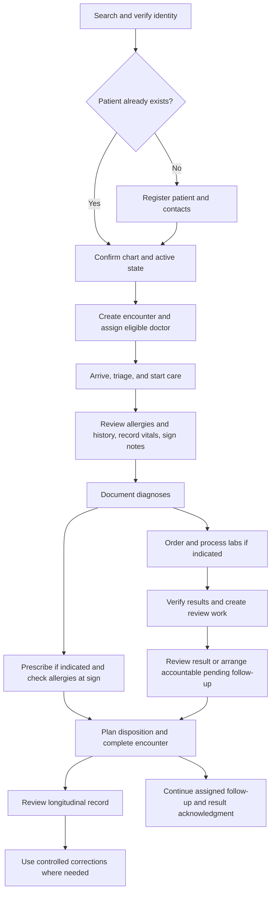
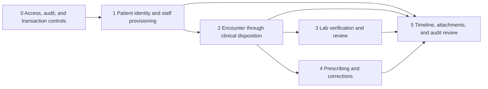

# Hospital API development roadmap

Repository review, 18 November 2026. Scope is outpatient clinical care in the current Hospital application. **Verified** means inspected source, configuration, migration or test. **Inference** identifies consequences of that evidence. **Proposed** identifies future work, including any schema or external dependency. This was a read-only review apart from this report. Test descriptions refer to inspected tests and recorded project evidence. No tests or deployments were run for this review, and live schema, infrastructure and data were not queried. Relative links resolve from this document.

## Start here

**Implementation update, 19 November 2026.** The initial demographics-only
PAT-003 slice is implemented. See the [PAT-003 guide](API4-PATIENT-DEMOGRAPHICS.md)
for STAFF authorization, its limitations, and available fields. PAT-004 is the next new
endpoint. The inventory and counts below describe the original review baseline.

**Implement PAT-003 first, then PAT-004.** These are the next two new endpoints. Patient search already returns a patient UUID. PAT-003 lets staff confirm that they selected the right chart, and PAT-004 lets authorized staff correct that chart's demographics. Both are Phase 1 work. Apply the Phase 0 authorization and audit controls that each endpoint needs before exposing it. Read [Phase 0](#h-phased-development-roadmap) for the broader foundation work.

### 1. PAT-003 · Get patient demographics

| Decision | First implementation |
| --- | --- |
| Endpoint | `GET /api/v1/hospital/patients/{id}` |
| Request | Patient UUID from PAT-002 search results. The first slice has no body or section parameters. |
| Success | `200` with `id`, `medicalRecordNumber`, `givenName`, `familyName`, `dateOfBirth`, `sexAtBirth` and `updatedAt` in the existing response envelope. Add the read version as an `ETag` when PAT-004 introduces record versioning. |
| Access | Require a valid User Service JWT with the STAFF role. Staff can read active demographics for registration and administrative workflows. DOCTOR, PATIENT, ADMIN and USER receive `403`. Missing or inactive records return `404`. An invalid UUID returns `400`. |
| Persistence | Query active `patients` with a dedicated DTO projection. Commit one allowed `view` event in `medical_record_access_logs` before returning data. Include the actor, patient, server correlation UUID and a controlled purpose. If access logging fails, return `500` without patient data. |
| Done when | A staff member can open an active chart by UUID supplied through an authorized workflow and confirm identity. Patient search is still ADMIN-only. Tests cover the response fields, role denial, missing or inactive records, and audit write failure. Contacts, allergies and history are later additions with separate permission rules. |

### 2. PAT-004 · Update patient demographics

| Decision | First implementation |
| --- | --- |
| Endpoint | `PATCH /api/v1/hospital/patients/{id}` |
| Request | `If-Match` from PAT-003 and a JSON object containing one or more of `givenName`, `familyName`, `dateOfBirth`, `sexAtBirth`, plus `reason`. Example body is shown below. Missing fields retain their values. Explicit `null` clears a nullable field. Reject empty patches and unknown fields. |
| Success | `200` with the updated PAT-003 demographics and a fresh `ETag`. |
| Access and validation | Require scoped demographic write authority. Apply the approved review policy to material identity changes such as DOB correction before allowing those changes. Require a nonblank reason, reuse registration name and enum validation, and reject future DOBs or dates later than a recorded deceased date. Deceased-date changes belong to the extended PAT-004 scope and require designated review. |
| Persistence | Add a future Flyway migration for the patient version and protected demographic revisions before shipping the endpoint. Lock the patient, check the submitted version, update the row, and insert the before/after revision and metadata-only `clinical_audit_logs` event in one transaction. Keep the reason in the protected revision. MRN and account linkage are outside this patch contract. |
| Done when | An authorized staff member can change an allowed field and retrieve the corrected chart. Tests cover `400` for invalid fields, `403` for missing write permission, `404` for unknown/inactive/out-of-scope patients, `428` for missing `If-Match`, and `412` for stale edits. Prove that revision or audit failure rolls back the update. |

```http
PATCH /api/v1/hospital/patients/{id}
If-Match: "7"
Content-Type: application/json

{"familyName":"Nguyen","reason":"Correct spelling confirmed by the patient"}
```

Start in the existing `patient` controller, service, DTO and repository packages. Reuse the current response envelope and access-log repository. See [PatientController](../src/main/java/com/hospitalmanagement/hospital/patient/controller/PatientController.java), [patient repositories](../src/main/java/com/hospitalmanagement/hospital/patient/repository), [API catalog](#d-complete-api-catalog), and [shared contract](#shared-contract-for-proposed-work).

## A. Executive assessment

**Verified.** This checkout is the Hospital Maven application. The parent integration reactor builds Hospital and User, and Compose also builds the independently maintained JWKS application. All three are Git submodules of the parent checkout. Hospital owns PostgreSQL clinical data. User owns MySQL accounts and refresh tokens along with registration, login, refresh, logout, and admin account listing/detail/activation. JWKS serves public keys by owner at `GET /api/v1/jwks/{owner}`. There is no cross-database FK. Hospital packages the parent's clinical migrations as classpath resources. The local `src/main/resources/db/migration` has only a tracked placeholder. The Hospital/JWKS POMs declare Spring Boot 4.1.2 and User declares 4.1.1. All three POMs declare Java 17 while Hospital's Dockerfile builds and runs on Java 21. Keep the Java 21 deployment convention and reconcile the compiler baseline explicitly before relying on Java 21 features. See [Hospital POM](../pom.xml), [Dockerfile](../Dockerfile), [integration POM](../../pom.xml), [submodule declarations](../../.gitmodules), [User POM](../../springboot-user-api/pom.xml), [JWKS POM](../../springboot-jwks-api/pom.xml), [User migrations](../../db/migration/user), and [Compose](../../docker-compose.yml).

**Verified.** Nine clinical Flyway migrations define 28 domain tables, excluding Flyway bookkeeping. The migrations cover patient identity and clinical background, doctors and specialties, encounters, vitals and notes, diagnoses, lab orders/results, prescriptions, follow-up, attachments and auditing. Hospital's clinical REST surface implements registration with optional contacts, patient search, and encounter status transitions. The status API operates on existing encounters and reads a narrow doctor mapping. Creating or assigning those records still requires data seeded outside the HTTP surface. See [database guide](DATABASE.md), [learning plan](API-LEARNING-PLAN.md), [V1–V9](../../db/migration/hospital) and [clinical mapping packages](../src/main/java/com/hospitalmanagement/hospital).

**Inference.** This is a working foundation for three narrow operations. A complete visit cannot be carried out through the API. Production blockers include coarse access, absent encounter initiation and documentation, missing lab and prescribing workflows, gaps in immutable correction and access auditing, registration log exposure, and unresolved deployment/recovery evidence. Existing constraints and telemetry provide a base for incremental work inside Hospital. Clinical permissions can start locally using verified User subjects, with User retaining identity and authentication. Future changes to token claims or immediate account disablement are explicit cross-service work. JWKS remains read-only throughout.

## B. Existing API inventory

Paths in this report are relative to `/api/v1/hospital` unless explicitly qualified. Clinical routes are counted by explicit method and path template. See [PatientController](../src/main/java/com/hospitalmanagement/hospital/patient/controller/PatientController.java), [EncounterController](../src/main/java/com/hospitalmanagement/hospital/encounter/controller/EncounterController.java), and [security rules](../src/main/java/com/hospitalmanagement/hospital/security/config/UserSecurityConfig.java).

| Method | Endpoint | Purpose | Status | Main tables | Production gaps |
| --- | --- | --- | --- | --- | --- |
| POST | `/patients` | Register a patient and optional initial contacts | EXISTING | `patients`, `patient_contacts`, `clinical_audit_logs` | Duplicate-person review, MRN issuance/correction policy, replay protection, scoped registration, safe logs |
| GET | `/patients` | Filter and page active patient summaries | EXISTING | `patients`, `medical_record_access_logs` | Scope-aware lookup, denied/failure coverage, transport privacy, workload limits |
| PATCH | `/encounters/{id}/status` | Apply guarded status changes with history | EXISTING | `medical_encounters`, `patients`, `doctors`, `encounter_status_histories`, `clinical_audit_logs` | Lifecycle prerequisites, actor scope, correction, exceptional closure and replay handling |

All three require `ADMIN` and parse the authenticated JWT subject as a UUID inside the service. The controllers send an `APIResponse` envelope. MVC validation and business failures use `GlobalExceptionHandler`, `ErrorCode` and `UnreadableRequestDetails`. Security-chain 401/403 responses follow framework handling. See [response classes](../src/main/java/com/hospitalmanagement/hospital/common/response) and [exception classes](../src/main/java/com/hospitalmanagement/hospital/common/exception).

### PAT-001 · Register patient

- **Contract.** JSON `medicalRecordNumber` (trimmed, nonblank, ≤40), `givenName` (nonblank, ≤100), optional `familyName` (≤100), `dateOfBirth` (past/present), `sexAtBirth` (`female`, `male`, `intersex`, `unknown`), and up to five non-null `contacts`. A contact accepts `contactType` (`self`, `emergency`, `guardian`), `contactName`, `relationship`, `phone`, `email`, `addressText` and `isPrimary` (default false). Contact lengths and email format are checked. At least one nonblank channel is required. Emergency and guardian contacts require a name. At most one primary per type. HTTP 201 returns `PATIENT_REGISTERED` with `id`, MRN, names, DOB, sex, `createdAt`, and `contactIds`. Patient registration is independent of User account creation.
- **Transaction and audit.** `registerPatient` flushes the patient, saves contacts, and flushes one `CREATE` event on `patients` in one transaction. Failures roll back all writes. The event uses the authenticated actor UUID and DB timestamp. There are no separate per-contact audit rows and the builder leaves `correlationId` unset. The permanent MRN constraint handles concurrent collisions. A retried request can return a duplicate conflict after the first response is lost.
- **Errors.** 400 `VALIDATION_ERROR`, `INVALID_REQUEST`, `INVALID_ENUM_VALUE`, `CONTACT_DETAILS_REQUIRED`, `CONTACT_NAME_REQUIRED`, `DUPLICATE_PRIMARY_CONTACT`. 401 `INVALID_ACTOR_ID` for an unparseable subject. 409 `PATIENT_ALREADY_EXISTS` specifically maps SQLSTATE `23505` plus `patients_medical_record_number_key`. Other persistence failures follow generic 500 handling.
- **Tests and limits.** DTO and controller tests cover rejection, nested enum paths and roles. `PatientServiceImplTest` exercises business branches. `PatientRegistrationIntegrationTest` covers actual storage, rollback, same-MRN race, and MRN reservation after soft deletion. Service log messages interpolate identifiers, the invalid subject, and a DB exception message on duplicates. The safe message provider suppresses throwable-bearing/framework messages, while this duplicate branch passes the exception message as an ordinary formatting argument. This path can expose MRNs and other data and its completion log runs before commit. Verify redaction on final encoded output when hardening.

Evidence: [registration DTOs](../src/main/java/com/hospitalmanagement/hospital/patient/dto/request), [PatientServiceImpl](../src/main/java/com/hospitalmanagement/hospital/patient/service/impl/PatientServiceImpl.java), [SafeMessageJsonProvider](../src/main/java/com/hospitalmanagement/hospital/logging/SafeMessageJsonProvider.java), [patient tests](../src/test/java/com/hospitalmanagement/hospital/patient), [registration guide](API1-PATIENT-REGISTRATION.md).

### PAT-002 · Search patients

- **Contract and validation.** Query `medicalRecordNumber` (exact, case-sensitive, 1–40), `name` (case-insensitive literal given/family substring, 2–100), and/or `dateOfBirth` (ISO date). At least one criterion, predicates combined by AND except the given/family OR, escaped LIKE metacharacters, and `deleted_at IS NULL`. `page` defaults to 0, `size` to 20 with a 100 cap, and `sort` to `createdAt,desc`. Sort permits `createdAt` or `medicalRecordNumber`, asc/desc, plus a UUID tie-break. Offsets exceeding a signed int are rejected. HTTP 200 gives `items` (`id`, MRN, names, DOB), `page`, `size`, `totalElements`, `totalPages`. Empty result pages are valid.
- **Transaction and audit.** A JPA specification and projected page/count run in the same write-capable transaction as one flushed `SEARCH`/`patient_lookup`/`ALLOWED` access event per returned item. Event subject and patient are stored, with `correlationId` unset. An audit write failure prevents returning results. Empty searches generate no rows. Denied, failed and empty searches have no patient access rows. Operational stage events use safe fields and commit-aware completion.
- **Errors and coverage.** 400 binding/validation or `PATIENT_SEARCH_FILTER_REQUIRED` and `PATIENT_SEARCH_PAGE_OUT_OF_RANGE`. 401 invalid actor and standard security errors. 500 `PATIENT_ACCESS_LOG_FAILED` for the mapped audit write failure, with generic handling for other persistence errors. Controller, service and logging tests cover contract and safe audit/log behavior. `PatientSearchIntegrationTest` covers filters, escaping, sorting, counts, rollback and projection query shape. Offset pagination and counts can drift under concurrent updates. Broad contains queries and counts can be expensive. Check proxy, browser and access logging for sensitive GET parameters. Search identifies candidates and lacks person-level duplicate adjudication or object scope.

Evidence: [PatientSpecifications](../src/main/java/com/hospitalmanagement/hospital/patient/repository/PatientSpecifications.java), [PatientSearchServiceImpl](../src/main/java/com/hospitalmanagement/hospital/patient/service/impl/PatientSearchServiceImpl.java), [patient tests](../src/test/java/com/hospitalmanagement/hospital/patient), [search guide](API2-PATIENT-SEARCH.md).

### ENC-001 · Change encounter status

- **Contract and validation.** UUID path and JSON `expectedStatus`, `status` (required lowercase enum values), optional trimmed `reason` (≤1,000, nonblank for cancellation). HTTP 200 gives `id`, `patientId`, `status`, `startedAt`, `endedAt`, `updatedAt`. Allowed transitions are scheduled→arrived/cancelled, arrived→in_progress/cancelled, and in_progress→completed. Terminal and same-state transitions conflict. Patient must exist and have no `deleted_at`. Starting requires an assigned, non-deleted doctor with an unexpired or unspecified license. Expiry is inclusive on the configured clinic date. Completion requires a doctor and valid start time. It does not assess visit documentation or arrange result follow-up.
- **Transaction and audit.** `changeStatus` sets a transaction-local three-second lock wait and obtains pessimistic locks in encounter→patient→doctor order, taking the doctor lock on start. Expected status is checked after locking. One transaction updates the header, appends status history with actor and reason, and records `UPDATE` or `CANCEL` in clinical audit. It uses one clinic-clock instant for transition/history/audit, flushes, then reloads trigger-managed `updatedAt`. Audit metadata excludes the reason text and does not set correlation. Operational completion is after commit. Replays after a successful change usually conflict with expected status.
- **Errors and coverage.** 400 malformed path/body/enum, validation or `ENCOUNTER_REASON_REQUIRED`. 401 `INVALID_ACTOR_ID`. 404 `ENCOUNTER_NOT_FOUND`. 409 `ENCOUNTER_STATUS_CONFLICT`, `ENCOUNTER_TRANSITION_NOT_ALLOWED`, `ENCOUNTER_PATIENT_INACTIVE`, `ENCOUNTER_DOCTOR_UNAVAILABLE`, `ENCOUNTER_START_REQUIRED`, `ENCOUNTER_LOCK_CONFLICT`. 500 `ENCOUNTER_CHANGE_FAILED` for caught persistence failures, with generic fallback at exception handling. Transition, controller and service tests cover guards. `EncounterStatusIntegrationTest` covers DB timestamps, failed writes, HTTP, concurrent writers, bounded waits and concurrent soft deletion. No API initiates encounters, assigns doctors, reopens visits or corrects them. The status workflow is a complete implementation of the listed transitions and a partial implementation of encounter management.

Evidence: [EncounterStatusServiceImpl](../src/main/java/com/hospitalmanagement/hospital/encounter/service/impl/EncounterStatusServiceImpl.java), [EncounterTransitions](../src/main/java/com/hospitalmanagement/hospital/encounter/service/EncounterTransitions.java), [encounter tests](../src/test/java/com/hospitalmanagement/hospital/encounter), [status guide](API3-ENCOUNTER-STATUS.md).

### Technical surface outside the clinical count

Hospital also serves `GET /technical/authentication` (subject, authorities, issuer), `GET /technical/jwks` (key lookup through the JWKS client), and `GET /technical/users/{id}` (User lookup through the User client, returning `InternalUserResponse`). They inherit the USER/ADMIN fallback. Health and OpenAPI/Swagger have separate public GET rules. The technical User proxy deserves explicit production routing and authorization review before staff onboarding uses the internal client. User validates the separate Hospital service token on `/internal/users/{id}`. Hospital's three clinical services perform local persistence, with no User RPC in their clinical transactions. See [technical controllers](../src/main/java/com/hospitalmanagement/hospital/controller), [clients](../src/main/java/com/hospitalmanagement/hospital/client), [internal JWT contract](../INTERNAL-JWT.md), [User internal security](../../springboot-user-api/src/main/java/com/hospitalmanagement/user/security/config/InternalApiSecurityConfig.java).

## C. Database coverage matrix

The migration tags link to the actual DDL. [V1](../../db/migration/hospital/V1__shared_database_functions.sql) defines timestamp and mutation helpers. [V9](../../db/migration/hospital/V9__integrity_guards_and_query_indexes.sql) makes histories and both log tables append-only, rejects DELETE/TRUNCATE on all 28 tables, preserves `created_at` and maintains `updated_at` on mutable records, constrains finite timestamps/numerics, and adds purpose-specific indexes. Finalization guards cover signed notes, verified results, signed prescriptions and completed/entered-in-error encounters. The prescription item trigger locks the parent for insert/update and requires an unsigned draft. Lifecycle graphs, required child counts, patient scope and many cross-table invariants remain application responsibilities. PostgreSQL CHECK expressions can accept NULL, so validate conditional requiredness explicitly. Clinical records use reasoned corrections, lifecycle states or new versions. `deleted_at` is reserved for retirement, deactivation or withdrawal as indicated below.

| Table | Domain | Existing coverage | Missing operations | Schema gaps |
| --- | --- | --- | --- | --- |
| `patients` | [V2](../../db/migration/hospital/V2__patient_management.sql) · Identity, demographics, deceased date, optional unique external subject, permanent unique MRN, soft deactivation | PAT-001 insert, PAT-002 active search, ENC-001 lock | PAT-003–005 detail/update/deactivate, PAT-012 MRN correction | Permanent alias/reserved number history, demographic revisions, controlled duplicate adjudication, roster/deactivation metadata |
| `patient_contacts` | V2 · Patient FK, self/emergency/guardian, usable channel, named non-self, active primary unique per type | PAT-001 initial insert | PAT-003 read, PAT-006–007 add/edit/retire/reassign primary | Consent/preferences if required, revision provenance for sensitive corrections |
| `patient_allergies` | V2 · Patient FK, free-text allergen/reaction, severity, onset, actor, active/resolved/error | None | PAT-003/008/009/013 maintain and read, RX-005/006 check | Coded allergen mapping, review/unknown/none distinction, linked revisions |
| `patient_medical_histories` | V2 · Patient FK, typed description, start/end, actor, active/resolved/error | None | PAT-003/010/011 maintain and read | Linked prior revisions and correction provenance |
| `doctors` | [V3](../../db/migration/hospital/V3__doctor_management.sql) · Unique external UUID and license authority/number, optional expiry, soft deactivation | ENC-001 lock/availability lookup | DOC-001–004 provision, search/update/deactivate, ENC-002/004 assignment | Clinical staff grants beyond doctors, deactivation reason history, availability scoping |
| `specialties` | V3 · Active code uniqueness, description, soft retirement | None | DOC-005–007 list/create/edit/retire | Service must prevent assignments to retired specialty and retain stable meanings |
| `doctor_specialties` | V3 · Doctor/specialty FKs, unique pair, active flag, one primary and primary must be active | None | DOC-001/008 read/replace assignments | Temporal assignment history if required beyond audit |
| `medical_encounters` | [V4](../../db/migration/hospital/V4__medical_encounters.sql) · Unique number, patient/doctor FKs, lifecycle, times, complaint/reasons, patient pairing | ENC-001 status and timestamps | ENC-002–005 initialize, assign, read and longitudinal navigation, ENC-014 correction | Encounter replacement linkage, assignment provenance and aborted-visit policy |
| `vital_signs` | V4 · Encounter FK, actor/time, at least one unit-specific numeric field, recorded/corrected/error | None | ENC-003/006/007 capture, read, correct | Same-encounter replacement link and single successor |
| `clinical_notes` | V4 · Encounter/doctor FKs, type/content, draft/signed/error, same-encounter amendment FK, signature checks | None | ENC-003/008–011 draft/edit/sign/amend/invalidate | Guard amendment ancestry and identifying the actual signer when different from author |
| `encounter_status_histories` | V4 · Encounter FK, changed status pair, actor/time/reason, append-only | ENC-001 append | ENC-002 initial event, ENC-003 read, ENC-014 correction event | Assignment provenance belongs in separate audit or history |
| `follow_up_plans` | V4 · Encounter and optional responsible doctor FKs, recommendation/due date, pending/completed/cancelled | None | ENC-003/012/013 assign/read/finish/cancel | Cancellation reason and accountable actor/handoff history |
| `diagnosis_codes` | [V5](../../db/migration/hospital/V5__diagnoses.sql) · Unique system/version/code, description and active flag | None | DIA-001 search and curated versioned import | Source/release provenance if not tracked via import manifest |
| `encounter_diagnoses` | V5 · Encounter/code/doctor FKs, diagnosis time and description, active/resolved/superseded/error, one active primary and one active use per code | None | DIA-002–004 assign/read/correct | Lock and append history at service layer, reasoned changes to primary designation |
| `diagnosis_histories` | V5 · Diagnosis FK, old/new codes/status/primary/description plus actor/reason/time | None | DIA-002/004 append, DIA-003 read | Stable same-timestamp ordering via ID tie-break |
| `lab_test_categories` | [V6](../../db/migration/hospital/V6__laboratory.sql) · Code/name, active-code uniqueness and soft retirement | None | LAB-001 lookup with category, governed import/retirement | Release provenance and active parent checks |
| `lab_tests` | V6 · Category FK, active unique code, specimen type/instructions | None | LAB-001 catalog, LAB-002/004 validate order items | Component definitions, units, ranges and versioned interpretation rules |
| `lab_orders` | V6 · Unique number, encounter/ordering doctor, priority, draft/ordered/in_progress/completed/cancelled, times/reason | None | LAB-002–006 draft/read/dispatch/coordinate/cancel, LAB-012 work queue | Aggregate state and ordered-item readiness are service rules, persistent notification outbox if used |
| `lab_order_items` | V6 · Order/test FKs, positive unique item number per order, specimen identifier, lifecycle/times/cancellation reason | None | LAB-002–006 compose and track collection/processing/cancellation | Stronger specimen identity and linkage where shared samples are used |
| `lab_results` | V6 · Item FK, component/revision, same-item/component predecessor, single successor and current row, exclusive value, range/flag and verifier/time checks | None | LAB-003/007–012 enter/review/verify/correct/acknowledge and find review work | Required component definitions, revision ordering, absent-result representation, acknowledgment history per revision |
| `medication_categories` | [V7](../../db/migration/hospital/V7__medications_and_prescriptions.sql) · Active-code unique, soft retirement | None | RX-001 category lookup, governed import/retirement | Source/release metadata if needed |
| `medications` | V7 · Category FK, active unique code, generic/brand/form/strength | None | RX-001–006 lookup, validation and historical representation | Coded ingredients/allergen mapping and versioned product semantics |
| `prescriptions` | V7 · Unique number, encounter/doctor FKs, draft/signed/cancelled/superseded/error, same-encounter single successor, reason for invalidating states | None | RX-002–006 create/read/edit/sign/cancel/replace | Allergy review and override provenance, signing policy and reliable downstream notice if integrated |
| `prescription_items` | V7 · Prescription/medication FKs, unique positive line number, dose/route/frequency, duration/dates, quantity/unit and PRN | None | RX-002–006 compose/read/edit and validate | Explicit draft withdrawal flag and structured dose fields when integration requires them |
| `prescription_histories` | V7 · Prescription FK, changed status pair and required reason, actor/time | None | RX-002/005/006 append, RX-003 read | Structured override evidence separate from free-text reason |
| `medical_attachments` | [V8](../../db/migration/hospital/V8__attachments_and_audit.sql) · Patient and optional same-patient encounter FK, uploader, provider/key unique, size and optional SHA-256, soft withdrawal | None | ATT-001–004 ingest/list/download/withdraw | Upload/scan status, durable storage reconciliation and version/retention metadata |
| `clinical_audit_logs` | V8 · Optional patient FK, actor/type, bounded operation/entity/reason code, correlation UUID and time | PAT-001 and ENC-001 append | AUD-001 scoped query, all write APIs append | Enforce actor/correlation policy and durable permissions; separate clinical revisions for value history |
| `medical_record_access_logs` | V8 · Required patient FK, actor, view/search/download/export, optional entity pair, purpose/outcome, correlation/time | PAT-002 allowed result rows | AUD-002 scoped query, all applicable reads and known-patient denied/failure events | Separate security-event sink for unresolved, empty or anonymous events; required patient FK precludes their representation here |

**Schema sequencing.** Preserve V1–V9 and add separately reviewed Flyway migrations in the parent. Phase 0 needs clinical role grants and object scopes (and a deliberate local identity invalidation policy), correlation linkage and scoped idempotency storage. Phase 1 needs demographic correction provenance before broad editing. Phase 2 needs revision links for allergy, history and vital corrections, allergy reconciliation state, encounter replacement/handoff provenance, and follow-up transitions with actor/reason. Phase 3 needs test-component definitions/versioning, acknowledged-result events, and a reliable work queue/outbox if notification delivery is in scope. Phase 4 needs medication ingredient mapping, sign-time review/override evidence and draft-line withdrawal. Phase 5 adds permanent MRN reservations/aliases and attachment lifecycle/checksum/scan state. Introduce DB version columns where `If-Match` is required, with backfill and compatible lock ordering. For past clinical data without metadata, preserve unknown provenance and require reconciliation before high-risk operations. No migration is implemented by this report.

## D. Complete API catalog

The phase column assigns one delivery or hardening phase per route. Dependencies name the immediate workflow prerequisites. Phase 0 controls apply across the catalog. Every path below uses `/api/v1/hospital`. IDs identify routes across implementation prompts.

### Patients and staff

| ID | Method | Endpoint | Purpose | Priority | Status | Dependencies | Phase |
| --- | --- | --- | --- | --- | --- | --- | --- |
| PAT-001 | POST | `/patients` | Register patient | P0 | EXISTING | PAT-002 for operator duplicate triage | 1 |
| PAT-002 | GET | `/patients` | Search patients | P0 | EXISTING | Scoped identity policy | 1 |
| PAT-003 | GET | `/patients/{id}` | Verify identity and read permitted record sections | P0 | MISSING | PAT-001/002 | 1 |
| PAT-004 | PATCH | `/patients/{id}` | Update or correct demographics | P0 | MISSING | PAT-003 | 1 |
| PAT-005 | PATCH | `/patients/{id}/status` | Deactivate or reactivate | P0 | MISSING | PAT-003 | 1 |
| PAT-006 | POST | `/patients/{id}/contacts` | Add contact | P0 | MISSING | PAT-003 | 1 |
| PAT-007 | PATCH | `/patients/{id}/contacts/{contactId}` | Edit, retire or change primary | P0 | MISSING | PAT-006 | 1 |
| PAT-008 | POST | `/patients/{id}/allergies` | Record allergy | P0 | MISSING | PAT-003 | 2 |
| PAT-009 | POST | `/patients/{id}/allergies/{allergyId}/corrections` | Correct, resolve or invalidate allergy | P0 | MISSING | PAT-008 | 2 |
| PAT-010 | POST | `/patients/{id}/medical-histories` | Record clinical background | P0 | MISSING | PAT-003 | 2 |
| PAT-011 | POST | `/patients/{id}/medical-histories/{historyId}/corrections` | Correct, resolve or invalidate history | P0 | MISSING | PAT-010 | 2 |
| PAT-012 | POST | `/patients/{id}/identifier-corrections` | Correct MRN and reserve old identifier | P1 | MISSING | PAT-001–004, alias migration | 5 |
| PAT-013 | POST | `/patients/{id}/allergy-reconciliations` | Record reviewed allergy status even when there are no allergy entries | P0 | MISSING | PAT-003, allergy reconciliation migration | 2 |
| DOC-001 | GET | `/doctors` | Find or retrieve scoped staff profiles with specialties | P0 | MISSING | Staff directory data | 1 |
| DOC-002 | POST | `/doctors` | Provision doctor profile | P0 | MISSING | User verification for linked account | 1 |
| DOC-003 | PATCH | `/doctors/{id}` | Maintain profile, license and account link | P0 | MISSING | DOC-001/002 | 1 |
| DOC-004 | PATCH | `/doctors/{id}/status` | Deactivate or reactivate doctor | P0 | MISSING | DOC-003 | 1 |
| DOC-005 | GET | `/specialties` | Find specialties | P0 | MISSING | Catalog data | 1 |
| DOC-006 | POST | `/specialties` | Add specialty | P0 | MISSING | Catalog administration | 1 |
| DOC-007 | PATCH | `/specialties/{id}` | Edit or retire specialty | P0 | MISSING | DOC-005/006 | 1 |
| DOC-008 | PUT | `/doctors/{id}/specialties` | Replace active specialty assignments | P0 | MISSING | DOC-001/005 | 1 |

### Encounters and diagnoses

| ID | Method | Endpoint | Purpose | Priority | Status | Dependencies | Phase |
| --- | --- | --- | --- | --- | --- | --- | --- |
| ENC-001 | PATCH | `/encounters/{id}/status` | Change visit state | P0 | EXISTING | ENC-002/004 for API-driven intake | 2 |
| ENC-002 | POST | `/encounters` | Open visit for identified patient | P0 | MISSING | PAT-003, DOC-001 if assigned | 2 |
| ENC-003 | GET | `/encounters/{id}` | Read visit and paged clinical sections | P0 | MISSING | ENC-002, later producers for sections | 2 |
| ENC-004 | PATCH | `/encounters/{id}` | Assign/reassign doctor or edit open-visit complaint | P0 | MISSING | ENC-002, DOC-001 | 2 |
| ENC-005 | GET | `/patients/{id}/clinical-timeline` | Review longitudinal clinical history | P1 | MISSING | PAT-003, ENC-003, DIA-003, LAB-003, RX-003 | 5 |
| ENC-006 | POST | `/encounters/{id}/vital-signs` | Record measurements | P0 | MISSING | ENC-002/003 | 2 |
| ENC-007 | POST | `/encounters/{id}/vital-signs/{vitalId}/corrections` | Correct or invalidate measurements | P0 | MISSING | ENC-006 | 2 |
| ENC-008 | POST | `/encounters/{id}/notes` | Create clinical note draft | P0 | MISSING | ENC-004 | 2 |
| ENC-009 | PATCH | `/encounters/{id}/notes/{noteId}` | Edit unsigned note | P0 | MISSING | ENC-008 | 2 |
| ENC-010 | PATCH | `/encounters/{id}/notes/{noteId}/status` | Sign or invalidate note | P0 | MISSING | ENC-008 | 2 |
| ENC-011 | POST | `/encounters/{id}/notes/{noteId}/amendments` | Add linked addendum draft | P0 | MISSING | ENC-010 | 2 |
| ENC-012 | POST | `/encounters/{id}/follow-up-plans` | Assign follow-up work | P0 | MISSING | ENC-002, DOC-001 | 2 |
| ENC-013 | PATCH | `/encounters/{id}/follow-up-plans/{planId}` | Edit, complete or cancel follow-up | P0 | MISSING | ENC-012 | 2 |
| ENC-014 | POST | `/encounters/{id}/corrections` | Invalidate erroneous visit and optionally create linked replacement | P0 | MISSING | ENC-002/003, ENC-001 lifecycle | 2 |
| DIA-001 | GET | `/diagnosis-codes` | Search active versioned codes | P0 | MISSING | Curated terminology import | 2 |
| DIA-002 | POST | `/encounters/{id}/diagnoses` | Assign diagnosis | P0 | MISSING | ENC-004, DIA-001 | 2 |
| DIA-003 | GET | `/encounters/{id}/diagnoses` | Read diagnoses and optional history | P0 | MISSING | ENC-002, DIA-002 | 2 |
| DIA-004 | POST | `/encounters/{id}/diagnoses/{diagnosisId}/corrections` | Correct code, designation or diagnosis state | P0 | MISSING | DIA-002/003 | 2 |

### Laboratory and prescribing

| ID | Method | Endpoint | Purpose | Priority | Status | Dependencies | Phase |
| --- | --- | --- | --- | --- | --- | --- | --- |
| LAB-001 | GET | `/lab-tests` | Search test catalog with components | P0 | MISSING | Governed lab catalog import | 3 |
| LAB-002 | POST | `/encounters/{id}/lab-orders` | Draft lab order and items | P0 | MISSING | ENC-004, LAB-001 | 3 |
| LAB-003 | GET | `/lab-orders/{id}` | Read order, specimens, result revisions and review state | P0 | MISSING | LAB-002 | 3 |
| LAB-004 | PATCH | `/lab-orders/{id}` | Edit draft order and items | P0 | MISSING | LAB-002 | 3 |
| LAB-005 | PATCH | `/lab-orders/{id}/status` | Submit, complete or cancel order | P0 | MISSING | LAB-002, LAB-006/009 for completion | 3 |
| LAB-006 | PATCH | `/lab-orders/{id}/items/{itemId}/status` | Collect, process, complete or cancel item | P0 | MISSING | LAB-005 submit, LAB-009 for completion | 3 |
| LAB-007 | POST | `/lab-orders/{id}/items/{itemId}/results` | Enter component result | P0 | MISSING | LAB-006 specimen/processing | 3 |
| LAB-008 | PATCH | `/lab-orders/{id}/items/{itemId}/results/{resultId}` | Edit preliminary result | P0 | MISSING | LAB-007 | 3 |
| LAB-009 | PATCH | `/lab-orders/{id}/items/{itemId}/results/{resultId}/status` | Verify or invalidate preliminary result | P0 | MISSING | LAB-007 | 3 |
| LAB-010 | POST | `/lab-orders/{id}/items/{itemId}/results/{resultId}/corrections` | Replace or invalidate verified result | P0 | MISSING | LAB-009 | 3 |
| LAB-011 | POST | `/lab-orders/{id}/items/{itemId}/results/{resultId}/acknowledgments` | Record clinician review and disposition | P0 | MISSING | LAB-009/010 | 3 |
| LAB-012 | GET | `/lab-orders` | Find assigned processing and result-review work | P0 | MISSING | LAB-002/005/011 | 3 |
| RX-001 | GET | `/medications` | Search curated prescribing catalog | P0 | MISSING | Governed medication import | 4 |
| RX-002 | POST | `/encounters/{id}/prescriptions` | Draft prescription and items | P0 | MISSING | ENC-004, RX-001 | 4 |
| RX-003 | GET | `/prescriptions/{id}` | Read prescription, items and history | P0 | MISSING | RX-002 | 4 |
| RX-004 | PATCH | `/prescriptions/{id}` | Edit unsigned prescription items | P0 | MISSING | RX-002 | 4 |
| RX-005 | PATCH | `/prescriptions/{id}/status` | Sign or cancel prescription | P0 | MISSING | RX-002, PAT-008/009/013 | 4 |
| RX-006 | POST | `/prescriptions/{id}/corrections` | Invalidate or issue a signed replacement | P0 | MISSING | RX-005, PAT-008/009/013 | 4 |

### Attachments and audit

| ID | Method | Endpoint | Purpose | Priority | Status | Dependencies | Phase |
| --- | --- | --- | --- | --- | --- | --- | --- |
| ATT-001 | POST | `/patients/{id}/attachments` | Upload to quarantine for validation | P2 | MISSING | PAT-003, optional ENC-003, storage/scan facility | 5 |
| ATT-002 | GET | `/patients/{id}/attachments` | List scoped attachment metadata/status | P2 | MISSING | ATT-001 | 5 |
| ATT-003 | GET | `/patients/{id}/attachments/{attachmentId}/content` | Retrieve clean attachment | P2 | MISSING | ATT-001/002 | 5 |
| ATT-004 | PATCH | `/patients/{id}/attachments/{attachmentId}/status` | Withdraw attachment from routine use | P2 | MISSING | ATT-001 | 5 |
| AUD-001 | GET | `/audit/clinical-events` | Inspect clinical change events | P1 | MISSING | Phase 0 audit writer, PAT-001/ENC-001 history | 5 |
| AUD-002 | GET | `/audit/record-access-events` | Inspect patient record access | P1 | MISSING | Phase 0 access writer, PAT-002 history | 5 |

## E. Detailed API specifications

### Shared contract for proposed work

- **Authorization.** Require a valid User JWT, canonical subject UUID and approved active clinical grant. Proposed capabilities are registrar (REG), staff/catalog administrator (ADM), care-team clinician (CLN), nurse/triage (NUR), lab worker (LAB), lab verifier (VER), prescriber (RX), and scoped audit reviewer (AUD). These resolve locally against authorized clinic/roster/case or work-queue assignment. Require independently authorized correction or approval where specified. ADM does not imply clinical care access. Scope collections before pagination and derive the actor from authentication. New routes require explicit security policy before exposure, including service-layer object checks and tests against `USER` fallback. Preserve current JWT claims and test deliberate compatibility changes to the three existing routes.
- **HTTP and fields.** JSON uses the existing envelope, UUIDs, UTC `Instant` timestamps and ISO dates in clinic context. Successful creates return 201 with location when readable, mutations 200, and attachment quarantine 202. Reads use bounded allowable filters and opaque stable cursors for new lists, with IDs as tiebreakers. Keep existing search page compatibility. Sensitive responses use `Cache-Control: no-store`; no raw patient data in telemetry or intermediary query logs. Reject unknown or immutable write fields for new commands. Default failures are 400 invalid shape/range, 401 authentication, 403 capability, 404 absent/out-of-scope record, 409 invalid state/uniqueness/lock contention, 412 stale `If-Match`, 428 absent required precondition, 429 throttled, 500 unexpected failure and 503 required external dependency unavailable. Document safe stable codes and retryability. Authentication challenge headers remain intact.
- **Transaction, concurrency and replay.** Each clinical write and its required audit/history commit together. Keep existing encounter→patient→doctor order when acquiring multiple such locks, then define deterministic child lock ordering per aggregate, with prescription header before items and lab order before items/results. Patient-only or doctor-only workflows must avoid locking encounters in reverse order. Enforce operation preconditions under lock, use versions for stale edits, and flush deliberate constraint outcomes before returning. Store scoped `Idempotency-Key` plus a canonical request digest and result reference in the write transaction for create/correction/transition commands. Same key and payload can replay only after authorization and scope recheck. Changed payload gives 409, and failed writes do not retain a successful key. Do not automatically resend signing or correction requests after an uncertain outcome. Existing expected-status behavior stays until deliberately versioned/documented.
- **Audit.** In the specifications below, **write audit** is a metadata-only `clinical_audit_logs` event with entity/patient when applicable, actor, operation, controlled reason code, server correlation UUID and timestamp. Keep substantive correction reasons and before/after values in access-controlled domain history. **Read audit** means access events before returning/streaming patient content, with per-patient attribution for scoped lists. Use separate durable security events for rejects or unresolved target identity. Never force a fabricated patient FK. For authenticated known-patient denials/failures, persist outside rollback where policy allows and avoid existence disclosure. Audit-review access itself goes to a separate restricted security trail to avoid recursive self-logging. Treat telemetry and clinical evidence as distinct stores.
- **Clinical safety.** Confirm patient identity using locally approved identifiers before chart selection or entry and re-confirm on context changes. Support exceptional identification through reviewed policy if identifiers are incomplete. Preserve entered values, units and measurement times and use clinically reviewed warning/override policies rather than discarding credible outliers. Every correction requires an authorized actor, reason and provenance. Prior records remain readable by authorized reviewers. Use the clinic timezone for date-only policy and UTC instants for event order. Changes after completion use correction or follow-up routes.

### Patient and staff

Each row specifies additional rules on top of the shared contract. The existing routes' exact contracts and current errors are in Section B.

| ID | Input → output | Role and scope | Persistence, validation, transaction and audit |
| --- | --- | --- | --- |
| PAT-001 | Existing registration DTO → patient and contact IDs | ADMIN today, proposed REG with scoped policy | Keep atomic patient/contact/audit insert. Add idempotent retry and approved duplicate review using PAT-002/003. Treat exact MRN conflict separately from possible person match. Authorized override records a controlled reason. Preserve MRN assignment contract until issuance strategy is agreed. Remove sensitive logs and move success after commit. |
| PAT-002 | Existing filters → paged summary | ADMIN today, proposed scoped REG/care team | Filter by caller scope before count and page. Keep read audit of returned patients in the same transaction. Bound broad queries and deep offsets, restrict counts to scoped results, and test privacy at gateway/browser/logging layers. |
| PAT-003 | Patient UUID, optional `section`, filters and cursor → identity header and one allowed section (contacts, allergies, histories or review state) | REG demographic/contact subset, care team clinical subset | Read `patients` and requested V2 child table in a read-plus-audit transaction. Explicit field allowlists, inactive records visible only to approved workflows. Validate parent scope and child status filters. |
| PAT-004 | Patch names, DOB, sex or deceased date plus reason/precondition → demographic snapshot/version | REG, designated reviewer for material identity or deceased changes | Lock patient, validate nonblank names and finite chronological dates, persist prior/new values in protected revisions plus write audit. No MRN or account link here. Invalid life-status/date combinations conflict or fail validation. |
| PAT-005 | `expectedStatus`, active/inactive target, reason → state/version | REG supervisor | Lock patient and check open encounter/pending safety obligations with compatible coordination, then set/clear `deleted_at` and append change history/audit. Keep MRN reserved. Reactivation must confirm identity and eligibility. Deceased status and deactivation are distinct policies. |
| PAT-006 | Existing contact shape → contact UUID and view | REG, scoped patient | `patients`/`patient_contacts`; enforce V2 channel/name and field rules. Under patient lock duplicate primary gives 409 or use PAT-007 for a deliberate swap. Write audit. |
| PAT-007 | Contact patch, optional retirement reason and primary transfer intent → revised contact and primary ID | REG | Lock patient and target/contact group; verify same parent. Clear previous primary before setting new one. `deleted_at` for retirement. Preserve edit provenance and audit changed contact IDs. Empty/invalid channels fail validation. |
| PAT-008 | Allergen coding/text, reaction, severity and onset → allergy and reconciliation freshness | CLN/NUR with approved documentation scope | Under patient lock insert `patient_allergies`, record actor and write audit. Require nonblank allergen, valid coding when present, finite onset, controlled severity and duplicate review. Make earlier reconciliation stale when clinically relevant. Support listing via PAT-003. |
| PAT-009 | Expected version, action (`replace`, `resolve`, `invalidate`), reason and replacement fields if needed → prior/current IDs and states | CLN, approved correction capability | Patient/allergy lock, validate ownership and current revision. Preserve old values, append linked replacement or lifecycle event and audit atomically. Reconcile patient review status under the same lock used by prescribing. |
| PAT-010 | Type, description and optional start/end → history record and version | CLN/NUR with approved documentation scope | Lock patient, insert `patient_medical_histories` plus write audit. Enforce V2 type/date ordering and nonblank description. |
| PAT-011 | Expected version, action, reason, replacement details → prior/current history states and IDs | CLN with correction capability | Validate parent/state/date consistency. Lock patient and row, preserve old values and append linked replacement or event plus audit. |
| PAT-012 | Current and proposed MRN, reason, reviewer/approval reference → current MRN, patient UUID, reserved alias | REG identity supervisor with independent approval policy | Lock patient and number reservations in deterministic order. Validate uniqueness across current and historical numbers, store old/new assignment with actor, and audit atomically. Alias lookup requires PAT-002 policy and tests. No routine renumbering, auto-merge or reuse. Queue suspected duplicate people for manual adjudication with no reassignment of clinical children in this phase. |
| PAT-013 | Expected allergy review/version, outcome (`known_allergy`, `none_reported`, `unknown`), review source and reason where applicable → reconciliation ID, state, actor and time | CLN/NUR with approved reconciliation capability | Lock patient and validate against current allergy revisions. Conflict if `none_reported` contradicts active entries or `known_allergy` lacks supporting entries. Append review event and write audit atomically. A subsequent material change stales the review. RX checks freshness and coverage at signing. |
| DOC-001 | Name/license/specialty/active filters, optional doctor ID, cursor → safe profiles and active assignments | REG/care team directory; ADM for identity-link detail | Read `doctors`, `doctor_specialties`, `specialties` with bounded projections. Apply explicit expired/inactive filter semantics. No patient access event. Security-log privileged identity-link inspection. |
| DOC-002 | Names, license authority/number/expiry and optional external user UUID → doctor ID/version | ADM onboarding | Verify linked account identity and activation via the existing User internal contract before DB transaction. Fail closed on required verification outage. Insert profile and write audit. Unique license pair and external UUID conflicts are 409. An unlinked profile cannot authorize clinical actions. |
| DOC-003 | Editable profile/license/account link, reason/version → updated profile | ADM | Separate User validation from local locked transaction. Check unique license/link; audit identity reassignment and invalidate stale clinical grants in same transaction. Disallow implicit reassignment of clinical records or self-grant. |
| DOC-004 | Expected and target status, reason → state/version | ADM with handoff oversight | Doctor lock, check active responsibility and require resolved or explicitly transferred obligations. Record deletion timestamp or reactivation, license verification and grant changes with audit. Coordinate with encounter start/sign under doctor lock, without taking encounter locks in reverse order. |
| DOC-005 | Code/name filters, optional status, cursor → specialty ID/code/name/description | Clinical staff, ADM for retired entries | Read `specialties`, filter retirement, use bounded pages. No patient audit. |
| DOC-006 | Code/name/description → specialty ID/version | ADM catalog | Insert with write audit, reject blank/oversize values and active code collisions. Treat code reuse as unsafe unless a governed versioning policy explicitly permits it. |
| DOC-007 | Name/description or explicit retirement, reason/version → specialty state/version | ADM catalog | Lock specialty, reject retirement while active assignments require resolution, preserve historical meaning and audit. Coordinate locking with DOC-008. |
| DOC-008 | Full active specialty ID set and optional primary, version → effective assignments | ADM | Lock doctor and referenced specialties, reject retired/missing entries, duplicate IDs and primary outside active set. Clear old primary before setting new one, reactivate existing unique pairs and deactivate omitted pairs, audit all affected assignments. Identical desired representation can return unchanged without duplicate clinical change events. |

### Encounter and diagnosis

| ID | Input → output | Role and scope | Persistence, validation, transaction and audit |
| --- | --- | --- | --- |
| ENC-001 | Existing status DTO → encounter state and times | ADMIN today. Proposed REG/NUR arrival, authorized clinician start/complete, scoped cancellation | Preserve transaction/history/error contract in B. Add clinician assignment check, signed documentation or documented exception, diagnosis/disposition policy, resolved ownership of pending results and follow-up, and reasoned abort policy. Keep early cancellation distinct from clinical corrections. Aborting after start requires a policy, explicit end/disposition and child-order review before any contract extension. |
| ENC-002 | Confirmed patient UUID, optional doctor, optional intake time and complaint → encounter ID, server number, scheduled state/version | REG or scoped clinician intake | Active patient check under lock, validate eligible assigned doctor when supplied. Insert `medical_encounters`, initial history from NULL and audit. Idempotency prevents duplicate visit creation. Reconfirm suspected duplicate active visit and allow a reasoned exception where approved. No scheduling API dependency. |
| ENC-003 | Encounter UUID, optional section/cursor → scoped header and one section | REG restricted header, assigned care team/authorized lab subset | Patient-scoped read audit, project status history, vitals, notes, follow-up and later lab/prescription summaries on request. Draft notes restricted to author/approved team. Never return unbounded chart graph. |
| ENC-004 | `doctorId` and/or complaint, reason/version → assignment, complaint and version | REG for pre-start assignment, CLN supervisor for clinical handoff | Lock encounter, patient and doctors consistently, validate eligible linked staff/licensure and ownership. Amend only allowed open states. In-progress reassignment requires explicit handoff and pending task ownership. Persist assignment provenance and write audit atomically. |
| ENC-005 | Patient UUID, bounded time/domain/status filters, cursor → chronologically ordered references and safe summaries | Scoped care team | Query authorized encounter/diagnosis/lab/RX/follow-up records, paginate on time and stable ID with a domain tie-break. Current-only default and explicit authorized historical revisions. Write read audit per patient/page and resolve details via domain APIs. |
| ENC-006 | `measuredAt` and unit-specific fields → vital set ID/status/times | NUR/CLN | Validate encounter state, unit, finite precision, BP pairing/coherence policy and at least one field. Surface reasoned warnings for unusual measurements. Save `vital_signs` with actor and write audit under encounter lock. |
| ENC-007 | Expected version, reason and optional replacement measurements → old/new IDs and states | NUR/CLN with correction capability | Verify same encounter under lock, preserve original measurement values. Mark corrected/error and optionally append linked replacement with audit. Reject stale/terminal original revision. |
| ENC-008 | `noteType`, content → author-derived draft ID/version | Assigned CLN | Verify encounter/actor, reserve addendum type for ENC-011, bound text, insert `clinical_notes` and audit under encounter lock. |
| ENC-009 | Content/type patch and version → draft version | Author or authorized delegate bound to care team | Lock encounter/note, check unsigned draft and allowlisted fields. Preserve authorship/type policy, write audit. Signed content edit gives conflict. |
| ENC-010 | Expected version, target (`signed`, `entered_in_error`), correction reason where required → status and signature time | Author as signer in first release; authorized CLN correction actor | Lock encounter/note and active signer. Sign draft at server time, including an addendum after completion; invalidate with reason and unchanged original content/timestamp. Audit `sign`/`correct` and respect V9 finalized guard. |
| ENC-011 | Signed note ID, content and reason → linked addendum draft ID/version | Scoped CLN with amendment authority | Lock and verify same encounter and eligible target, reject branching/cycles per amendment policy, append `amends_note_id` draft plus audit. Sign via ENC-010. Original remains intact. |
| ENC-012 | Recommendation, due date and responsible doctor → pending plan ID/version | Scoped CLN | Require accountable owner, due date rules and eligible doctor. Lock encounter and verify disposition, insert `follow_up_plans` and audit. Allow authorized post-completion follow-up without reopening visit. |
| ENC-013 | Patch pending text/due date/owner or explicit complete/cancel with expected status and reason → plan state/times | Responsible CLN or supervisor | Lock parent/child. Reject mixed edit/transition commands. Preserve completion timestamp invariant and actor/reason event; write audit. Terminal plan replacement uses a new plan and linkage/provenance. |
| ENC-014 | Expected version, reason and optional replacement intent → corrected encounter ID and optional new visit ID | Clinical supervisor with independent review for wrong-patient records | Check child lab/RX/note implications and unresolved safety tasks. Under encounter lock mark original entered_in_error with reason only where required by V9, append status history and audit, optionally create linked replacement. Never move original children or disclose an old patient's record to a replacement patient's care team. Patient identity mismatch requires separate privileged review. |
| DIA-001 | System/version/code/text filters and cursor → active code IDs and descriptions | Scoped care staff | Read `diagnosis_codes`, use versioned curated releases and bounded queries. No patient audit. Retired versions remain resolvable from stored clinical records. |
| DIA-002 | Code ID, clinical description, primary flag and optional diagnosis time → diagnosis ID/state | Assigned CLN | Validate active code and clinician. Lock encounter, enforce one active primary and no active duplicate code, append initial `diagnosis_histories` with controlled creation reason and write audit. Concurrent primary/code changes conflict. |
| DIA-003 | Status filter, optional diagnosis ID/history view and cursor → current diagnoses or ordered revisions | Scoped care team | Read `encounter_diagnoses`, `diagnosis_codes`, optional `diagnosis_histories`, write read audit. Include inactive entries with explicit permission/filter. |
| DIA-004 | Version, reason, target code/state/primary or explicit primary swap → changed IDs, states and history | Scoped CLN with correction authority | Lock encounter and affected diagnoses. Clear prior primary before promoting replacement; append full before/after history for each changed row and audit atomically. Validate active catalog references for new codes; never silently resolve duplicate code conflicts. |

### Laboratory and prescribing

Lab and medication catalogs begin with approved, versioned imports, manifest provenance, controlled activation and rollback by release selection. No public catalog mutation routes are required for the first workflow. Never change the meaning of a code already referenced by an order. Historical details use the original code/version even when retired. Laboratory transition and completion operations serialize on the order, then the item and result. Prescribing serializes allergy review against allergy updates through the patient lock and serializes line edits against the prescription lock and V9 trigger.

| ID | Input → output | Role and scope | Persistence, validation, transaction and audit |
| --- | --- | --- | --- |
| LAB-001 | Code/text/category/version filters, cursor → test ID, specimen requirements, versioned components and units | CLN/LAB/VER | Read `lab_tests`, `lab_test_categories` and proposed component definitions. Filter retired tests/categories. No patient audit. |
| LAB-002 | Test IDs, priority and indication → order ID/number, draft, item IDs | Ordering CLN | Lock encounter, validate active tests and catalog versions, require bounded distinct selections unless repeats are explicitly justified. Allocate positive stable item numbers. Insert header/items/audit atomically. Draft item rows default ordered in V6, so collection must gate on header submission. |
| LAB-003 | Order UUID, optional item/component/revision filters and cursor → header, specimens, permitted results and review status | Assigned care team or lab work queue | Read order/item/result/acknowledgment rows with patient read audit and bounded sections. Role rules govern preliminary visibility, never present it as verified. Return current and predecessor IDs where relevant. |
| LAB-004 | Draft priority/indication and item change commands with version → edited order and item states | Ordering CLN | Under order lock require draft, preserve prior item IDs and cancel omitted lines with reason since DELETE is guarded. Validate catalog and at least one orderable item at submission. Audit header and changed lines. |
| LAB-005 | Expected and target status, cancellation reason → order state/times | Ordering CLN submits; authorized lab staff complete; authorized CLN/LAB cancellation by state | Draft→ordered requires active items, eligibility and sets orderedAt. First processing can move parent to in_progress through LAB-006. Complete only with all items terminal, at least one completed item, and required current results verified. Cancellation atomically cancels eligible outstanding items and records reason; processed/verified work requires disposition review. Persist header/items/audit and durable tasks if needed. |
| LAB-006 | Expected/target state, specimen ID and collection time or reason → item/parent state | LAB/NUR collect under scope; LAB processes; VER or authorized lab staff completes | Lock order/item, require submitted order and match specimen to patient/order. Move ordered→collected→in_progress→completed, with authorized early cancellation and result-aware exceptions. Completion requires governed required components verified or explicitly recorded exception if supported by migration. Set timestamps, update parent as appropriate, and audit. |
| LAB-007 | Component code, exactly one numeric/text value, units, range/flag, observed time → preliminary result ID/revision | LAB | Lock order/item, validate processing state, matching component/version, finite values, permissible units, timestamps and specimen. One current row per component, conflict on duplicate. Insert preliminary plus audit. Use versioned ranges or explicit approved deviations. |
| LAB-008 | Version and preliminary value/range/time edits → revised preliminary record/version | LAB | Lock aggregate, verify preliminary state and correct parent. Validate as LAB-007, preserve edit provenance in controlled history and audit. Once verified, route changes through LAB-010. |
| LAB-009 | Expected status/version, verify or invalidate, reason for invalidation → state, verifier/time, alert work item when required | VER, independent of submitter where lab policy requires | Confirm specimen, value, component, units, valid range and abnormal/critical classification. Set server verifier/time together or invalidate with reason. Persist result, audit and critical-review work item atomically. Approved critical escalation has an accountable owner and deadline. |
| LAB-010 | Verified result UUID/revision, reason, replacement fields or invalidate intent → prior status, optional verified successor, review task | VER with correction authority | Lock current result via order/item. Validate fresh replacement as in LAB-009. Mark old superseded with reason before inserting same component revision+1 to satisfy partial uniqueness; rollback both on failure. Invalidation preserves content and records entered_in_error. Write audit and reopen review workload for changed results, including completed encounters. |
| LAB-011 | Result revision ID, disposition and optional approved follow-up reference → review actor/time/outcome and open/escalated state | Assigned CLN or approved covering clinician | Validate verified current revision and authorized recipient under lock. Append acknowledgment and audit, keep clinical action distinguishable from receipt, and throttle duplicate acknowledgments scoped to task/revision. Corrected result creates new work; prior acknowledgments remain historical. |
| LAB-012 | Queue type, status/priority/time filters and cursor → scoped order/task IDs, priority, deadline and state | LAB/VER processing scope or CLN review/coverage scope | Query orders/items and persisted result-review work with indexed scope and stable pagination. Only assigned clinic/actor queues are visible, and patient details are minimized. Write read audit for any returned patient disclosure. Use LAB-003 for details. |
| RX-001 | Code/generic/brand/category filters, cursor → medication/form/strength/ingredient and available route metadata | Prescribers/care team | Read medications/categories and proposed mappings; restrict active selection to governed data. No patient audit. |
| RX-002 | Medication lines with dosage, route, frequency, duration or start/end, quantity/unit, instructions and PRN → draft ID/number/version and items | Assigned RX | Verify encounter, linked doctor, line and catalog rules. Require at least one active line, positive quantity/duration, chronological and consistent dates, bounded text, clinically reviewed PRN instruction rules. Insert draft, lines, initial history and audit atomically. |
| RX-003 | Prescription UUID, optional history cursor → header, active items and authorized historical items/history | Scoped care team | Query `prescriptions`, `prescription_items`, referenced catalog and `prescription_histories`. Read audit before response. Preserve exact signed content across catalog changes. |
| RX-004 | Version and line addition/update/withdrawal commands → draft items and version | Assigning RX, with approved draft delegation | Lock draft and items; validate as RX-002 and preserve stable numbers. Add explicit `withdrawn_at`/state in migration to omit draft lines with reason and audit. V9 INSERT/UPDATE trigger requires unsigned draft. No delete. |
| RX-005 | Expected status/version, sign/cancel, cancellation reason or permitted alert acknowledgment → state/sign time and history reference | Licensed linked RX for sign, authorized RX/supervisor for cancellation | Verify scoped eligible clinician, active lines and clinically usable units/routes. Lock aggregate and patient, recheck recorded allergies and reconciliation/ingredient coverage at sign; persist review and any explicitly allowed override evidence. Unresolved matches/unknown status follow clinical policy, with escalation or block when required. Sign server-side or cancel with reason and downstream communication as applicable. Header/history/audit atomically. |
| RX-006 | Original signed version, reason, corrected lines or invalidate intent → prior state and optional signed replacement | Authorized RX with independent review when policy requires | Under locks validate predecessor and encounter; generate unique number and a same-encounter draft successor, insert items while draft, review allergies as RX-005, then sign successor and supersede predecessor atomically. Invalidation preserves original content. Write both histories, audit and durable notification task if integrated. |

Allergy matching is a targeted clinical safety aid. Ingredient mappings, coding coverage and quality of recorded allergies determine its reach. Local clinical policy determines which warnings require verification, override evidence or a block. Interactions, dose appropriateness and other prescribing checks need their own clinically governed capabilities. Verification and acknowledgment of a laboratory result are separate responsibilities. Review work needs escalation even after a visit is closed.

### Attachment and audit

| ID | Input → output | Role and scope | Persistence, validation, transaction and audit |
| --- | --- | --- | --- |
| ATT-001 | Multipart binary, optional encounter UUID, description and declared metadata → attachment ID and quarantine state | Authorized care team uploader | Verify matching patient/encounter, enforce size/type quotas, compute checksum and use random private storage key. Persist staging/scan state, metadata and audit with idempotency. PostgreSQL and object storage do not share a transaction; reconcile staged/orphaned objects and retry scan safely. Reject 413/415 for size/type, fail unavailable storage safely. |
| ATT-002 | Encounter/status filters and cursor → permitted metadata/status, no storage key | Scoped care team | Filter withdrawn or non-clean files from routine view. Use read audit and enforce patient FK scope. Authorized reviewers may see quarantined status metadata. |
| ATT-003 | Attachment UUID and optional supported range → controlled content headers and binary | Authorized care team reader | Recheck clean state and linkage, commit download audit before streaming/issuing short-lived access. Avoid public URLs and unsafe dispositions. Use private encryption and access control. Return 404 when outside scope or unavailable by policy; preserve separate delivery-failure evidence where possible. |
| ATT-004 | Expected version, withdrawal state/reason → metadata status | Authorized records custodian | Lock row, mark withdrawal, revoke new downloads, audit and retain object per approved hold/retention. Reconcile prior issued grants within their bounded lifetime. |
| AUD-001 | Patient/entity/actor/operation and bounded time filters, cursor → metadata-only change events | AUD with scoped review purpose | Read `clinical_audit_logs` via `(occurred_at,id)` and indexed scopes. Restrict global/null-patient events to explicit permissions. Separate security trail for reviewer queries. Reject unauthorized export or excessive windows. |
| AUD-002 | Patient/actor/operation/outcome/time filters, cursor → access events without payload | AUD with scoped review purpose | Read `medical_record_access_logs` with required scope and bounded scan. Record reviewer access in restricted security trail. This endpoint exposes existing typed access events, with unresolved-target security events handled by protected operational review. |

## F. End-to-end clinical workflow coverage



| Clinical step | Current coverage | Proposed API and acceptance boundary |
| --- | --- | --- |
| Search, identify and register | PAT-002 finds candidates and PAT-001 registers. No detail or duplicate triage workflow. | PAT-003 confirms correct chart. PAT-004–007 handle identity/contact stewardship, PAT-012 handles controlled MRN correction. |
| Prepare clinic staff and open a visit | ENC-001 reads an already assigned doctor. Creation and assignment are absent. | DOC-001–008 establish authoritative staff data. ENC-002/004 create and assign with eligibility and handoff checks. |
| Arrive/start and record triage | ENC-001 advances seeded rows. | ENC-003/006/007 read, record and correct vitals. PAT-008–011 capture patient history and allergies. |
| Document clinical reasoning | No notes or diagnosis API. | ENC-008–011 support authoring/signature/amendment; DIA-001–004 support versioned codes, primary/secondary assignments and corrections. |
| Order lab work, collect and process specimens | No lab API. | LAB-001–006 enforce header/line state and specimen scope. LAB-007–010 manage preliminary, verified and corrected revisions. |
| Review and act on lab results | No review workflow. | LAB-012 finds assigned work, LAB-003/011 expose verified revisions and accountable action, and unresolved tasks persist across completion. |
| Prescribe where indicated | No prescribing API. | RX-001–006 support draft, sign, cancel and linked corrections with an allergy review record. |
| Plan follow-up, complete or correct visit | ENC-001 completes or cancels within its narrow transition rules. | ENC-012/013 maintain accountable follow-up. Harden ENC-001 close checks, preserve exceptional disposition, and use ENC-014 for erroneous records. |
| Review longitudinal record and access trail | PAT-002 searches demographics. | ENC-005 integrates domain summaries. ATT-001–004 support safe evidence handling. AUD-001/002 enable scoped review. |

Clinical features can be tested independently before integration. Lab and prescribing are conditional branches based on clinical indication. Completion supports pending results via identified ownership and escalation; it never invents diagnoses/results or silently closes outstanding review work.

## G. Production readiness gap analysis

| Area | Verified baseline | Gap and release criterion |
| --- | --- | --- |
| User JWT | `JwtDecoderConfig` uses RS256 and configured JWKS URI, issuer/time checks, required `kid`, subject, `iat`, `exp`, and skew. `JwtRoleConverter` maps claim 1/2 to USER/ADMIN. JWT tests exercise rotation, invalid claims and JWKS outages. | No inbound Hospital audience check or clinical object authorization in the inspected policy. Preserve issued claims and test across services. Adding audience or immediate invalidation requires explicit User coordination if the local authorization layer cannot enforce policy alone. Use scoped local grants, activation strategy, explicit permissions per route and fail-closed negative tests. |
| Service-to-service | Hospital's `ServiceTokenInterceptor` sends separately signed short-lived RS256 internal bearer tokens to User when enabled. User uses a dedicated decoder and `SERVICE_HOSPITAL` check. Compose enables the sender by default; standalone flags default off. Caller metadata headers are diagnostic. | Restrict technical proxies to intended operators or deployment profile, verify rotation and outage handling, cap timeouts, and use explicit allowlists for trust boundaries. Keep User calls outside clinical transactions. Do not change JWKS. |
| Clinical safety | MRN uniqueness, existing lifecycle checks, immutable finalized content and references establish guardrails. | Enable two-identifier workflow, identity correction controls, clinical roles and handoff, reasoned lifecycle gates, allergy reconciliation, critical result policy, change provenance and post-close follow-up. Have clinicians approve the safety policies and test realistic error cases. |
| Database integrity | V1–V9 define local FKs, partial uniqueness, timestamp/finite numeric guards, restricted deletion and query indexes. Flyway is configured for validation and clean disabled; Hibernate validates mappings and open-in-view is off. | Apply forward-only migrations and data backfills, prove prior revision retention, deal with legacy unknown values, and separate migration/application privileges. V9 does not supply cross-row aggregate completion rules or comprehensive state machines. Verify rollout on an empty DB and upgraded representative schema. |
| Transactions | Registration, search and status operations use service transactions. Encounter has lock timeout and status precondition. | Agree cross-domain lock order. Atomically provide aggregate/history/audit and persistent command deduplication. Test rollback at every required write, deadlocks/lock waits, clock skew, competing identity/clinical edits and concurrent sign/verify races. Use outbox/reconciliation where an external side effect is required. |
| Clinical audit/access | Metadata-only audit writes for registration and status, per-result allowed search access writes, append-only V9 guards. | Capture correlation and authenticated provenance consistently; extend read/change coverage and protect history access. Model unsuccessful/unattributable attempts in an appropriate security store. Test audit unavailability, commit-before-release, authorized review and safe retention/access to audit data. |
| Errors and sensitive data | MVC has controlled error codes and sanitized enum diagnostics. Request filter avoids bodies/query/raw paths in completed events and propagates correlation. Logback has structured encoding and safe throwable provider. | Repair registration logging. Test final message output, proxy/access/query logs, SQL exception paths and trace attribute output. Align documented security error behavior, never emit patient payloads or tokens in logs. Configure secure transport/data storage, secret rotation, no-store and role-scoped fields. |
| Performance | Exact MRN unique index, stable offset paging, search projection and several time/parent indexes. Existing metrics include HTTP/security/client/Hikari instrumentation. | Measure query plans with synthetic representative data. Name contains and count can scan; consider bounded filters or measured trigram indexes after plan evidence. Add keyset pagination/index tie-breaks to large new lists and test audit insert amplification and lock contention under load. |
| Observability | Source includes private Prometheus listener, bounded metrics, JSON logs, W3C tracing with safe span export and opt-in standalone OTLP. Compose config wires Prometheus, Collector/Tempo, Fluent Bit, Loki/OpenSearch and Grafana, with dashboards/runbooks present. | Keep telemetry label cardinality bounded. Define SLOs with owners and add auditable workflow alarms for stalled follow-up, verifier queues, audit persistence and saturation. The repository records isolated security/recovery exercises and open live TLS, durability, notification, and capacity gates. Verify these on the intended deployment. |
| Test evidence | Unit/MockMvc, client/JWT, OpenAPI, logging/metrics/tracing and opt-in PostgreSQL suites are present. `ClinicalSchemaMigrationTest` checks table/FK inventory, triggers/integrity and migration revalidation. | CI should run clean and upgrade DB scenarios and mandatory PostgreSQL workflow suites in disposable environments. Add scoped authorization matrices, replay/rollback/load tests, cross-service contract coverage and true outpatient end-to-end verification. Historical test results do not attest this review or a deployed release. |
| Deployment and recovery | Parent Compose documents PostgreSQL 17.6, MySQL, per-app env configuration, migration jobs, loopback host bindings and health checks. Hospital image runs as non-root on Java 21. Dev Compose disables OpenSearch security. Secure telemetry candidate and debug overlay are separate. | Choose migration job ownership and verify application role permissions, startup dependency checks, TLS and secrets handling. Prove app/data/attachments backup and restore with agreed RPO/RTO, deployment rollback, off-host persistence and external incident delivery. Keep debugging and unrestricted diagnostics out of production. |

Evidence for this assessment: [JWT implementation](../src/main/java/com/hospitalmanagement/hospital/security/jwt), [User internal JWT decoder](../../springboot-user-api/src/main/java/com/hospitalmanagement/user/security/jwt/internal/InternalJwtDecoderConfig.java), [hospital configuration](../src/main/resources/application.properties), [environment example](../.env.example), [database startup and migrations tests](../src/test/java/com/hospitalmanagement/hospital), [Logback](../src/main/resources/logback-spring.xml), [metrics](../src/main/java/com/hospitalmanagement/hospital/metrics), [tracing](../src/main/java/com/hospitalmanagement/hospital/tracing), [Compose](../../docker-compose.yml), [debug overlay](../../docker-compose.debug.yml), [observability assessment](../../observability/production-readiness.md), [isolated verification](../../observability/phase6b-verification.md), [backup and restore](../../observability/backup-restore.md).

Regulatory obligations depend on deployment context and policies that were outside this review. Production sign-off should include locally owned retention/access and clinical governance decisions. For optional integration, keep stable identifiers, terminology versions and provenance so clinical records can be mapped at the boundary. A future lab export could map component results to FHIR `Observation` and report context to `DiagnosticReport`. [HL7 Observation](https://hl7.org/fhir/R4/observation.html), [HL7 DiagnosticReport](https://hl7.org/fhir/R4/diagnosticreport.html).

## H. Phased development roadmap



The dependency diagram allows Phases 3 and 4 to proceed independently after Phase 2. The implementation sequence below gives lab verification and review first. In the table, Done includes OpenAPI updates, code and migration review, release notes for client-impacting changes, passing automated tests and validated rollback/forward-recovery procedures where appropriate. Phase 0 has no new public route. Its changes to existing routes ship with their assigned hardening phase or as isolated fixes before those phases.

| Phase and objective | APIs and tables | Dependencies, validation and authorization | Required tests | Acceptance criteria and definition of done |
| --- | --- | --- | --- | --- |
| **0 · Clinical access and transaction foundation.** Establish controls before opening new routes. | Shared policies for PAT-001/002, ENC-001 and all new routes. Audit tables plus proposed local grants/scope, idempotency and server correlation support. | Existing User/JWKS contract and PostgreSQL. Approve authority matrix, audit metadata, migration ownership, replays, clinical workflow locks and Java build baseline. | JWT/role/scope and default-deny tests, response redaction, metadata-only raw encoder checks, stale/replay races and transactional audit failure with PostgreSQL. | Scope denied before PHI disclosure. Signed user identity and clinical grants have distinct roles. Audit/replay failure behavior verified. No additions to public route count. |
| **1 · Patient identity and staff provisioning.** Find, verify, create and maintain safe chart and clinician identities. | PAT-001–007, DOC-001–008. V2 patients/contacts, V3 doctors/specialties/assignments, audit and provenance. | Phase 0. Validate MRN and demographics, primary contact/specialty rules, eligible scope, staff linking through existing User API. Confirm this workflow can operate safely with existing manual review for suspected duplicates. | HTTP/DB duplicate MRN race and replay, inactive search, discharge/deactivation guards, invalid primary transfer, unauthorized object scopes, external account verification failure, distinctive safe error bodies. | Registrar can confirm identity and update demographics and contacts; administrator can provision eligible clinicians and specialties with durable audit. Test rollback and clinical role isolation. |
| **2 · Document and complete an outpatient visit.** Support a complete documentation and disposition path. | ENC-001–004, ENC-006–014, PAT-008–011/013, DIA-001–004. V2 background, V3 doctor checks, V4 encounter/vitals/notes/history/follow-up and V5 diagnosis plus revisions/audit. | Phases 0–1 and approved diagnosis release. Validate active patient/doctor, assignment, signing, allergy reconciliation and history documentation, role-scoped corrections, disposition and follow-up prerequisites. | Synthetic end-to-end flow, concurrent assignment/start/close, primary diagnosis race, signed note immutability, corrected vital provenance, allergy reconciliation with zero entries, actor-restricted addenda, correction rollback and late follow-up. | Complete a seeded-catalog visit through HTTP without SQL fixtures for patient, doctor or visit. Prove immutable signatures and reasoned corrections. P0 expanded lab/RX workflows ship in Phases 3–4. |
| **3 · Lab ordering, verification and review.** Close the loop from order to accountable action. | LAB-001–012. V6 catalogs/orders/items/results plus component definitions, review events/work and audit. | Phase 2, approved lab catalog/specimen policy, credentialed lab and verifying roles. Clarify review service levels and whether external delivery is needed. | Aggregate lifecycle, wrong specimen and cross-patient rejection, parallel edits and verification, current revision uniqueness, rollback after supersession, corrected-result re-review, queue scope, unresolved critical escalation and post-visit review. | Authorized care team can place, find and act on a verified result. Earlier values and acknowledgments remain traceable. Demonstrate recovery of the critical work queue. |
| **4 · Prescribing.** Publish controlled prescriptions with allergy review. | RX-001–006. V7 medication and prescription tables plus patient allergies/review and mappings, provenance and audit. | Phase 2 and approved medication catalog. Active authorized prescriber, valid dosing fields, documented reconciliation and defined medication-allergy policy. | V9 signed-item mutation, concurrent edits/sign/allergy update, unknown and matched allergy cases, override authorization, cancellation, linked replacement and multi-write rollback. | Prescriber can draft, sign, read, cancel and correct. Signature preserves active lines and attached safety evidence. Failed signing or replacement yields no partial clinical history. |
| **5 · Longitudinal access and oversight.** Add historical review, controlled MRN correction and secure attachment handling. | PAT-012, ENC-005, ATT-001–004, AUD-001–002. Patient/encounter and domain joins, aliases, V8 attachments/audit, storage/scan state. | Phases 1–4 for full clinical timeline. Restricted identity and audit roles, private object storage and scan/recovery infrastructure for attachments. | Aliased identifier race and audit, stable timeline pages and scope, historical filters, forged cross-patient links, quarantine/poisoned file handling, storage outage/orphan cleanup, denied downloads, auditable query performance and restore drill. | Scope-safe timeline and controlled MRN correction verified. Private clean files retrievable only after audit. Audit reviewers can reconstruct who accessed or changed records. Release gate includes representative workload and recovery evidence. |

Optional P3 expansion stays outside these phases and route counts. Consider appointment scheduling, billing/insurance, pharmacy inventory, inpatient care and formal interoperability once a validated operational need exists. Each needs independent scope and ownership decisions.

## I. Recommended implementation order

1. Start **Phase 0** immediately after the three existing APIs. Establish local clinical grants and case scope, explicit route policy, atomic audit and replay semantics. Fix registration's unsafe logging path and add its encoded-log regression early.
2. Deliver PAT-003 as the first new endpoint and verify it with scoped PAT-002. Deliver PAT-004 next, then finish PAT-001 hardening and PAT-005–007. Use the [first two implementation briefs](#start-here) for the initial contracts and tests.
3. Deliver DOC-005–007 and DOC-001–004, then DOC-008. Verify User account linking and authority without modifying the JWKS service.
4. Deliver ENC-002/003/004 with ENC-001 integration. Add PAT-008–011/013, ENC-006–011 and DIA-001–004 before enforcing clinical completion. Finish ENC-012–014 and enable reviewed completion/correction rules.
5. Deliver LAB-001–006, then LAB-007–012 as one verified release before lab use. Exercise reassignment and correction while an encounter is complete.
6. Deliver RX-001–004, then RX-005/006 with the sign-time allergy policy and provenance tests before prescribing is enabled.
7. Deliver PAT-012, ENC-005 and AUD-001/002, then ATT-001–004 after the secure storage workflow passes. Complete production deployment, safety and recovery acceptance before using real patient data.

## J. Final statistics

Count one explicit clinical HTTP method plus canonical path template. Section D includes three narrow implemented routes and 60 new routes. `PARTIAL` is reserved for a mapped operation that supplies only a subset of its current documented behavior. There are zero such routes in this review. Production hardening of an implemented operation and incomplete domain workflows are tracked separately from route status. Technical/Actuator/Swagger routes, User/JWKS endpoints, implicit HEAD/OPTIONS, trailing-slash variants, bulk catalog imports, and optional P3 ideas are excluded. Paths with distinct HTTP methods are distinct operations.

| Domain | Existing | Partial | Missing | Total | P0 | P1 | P2 | P3 |
| --- | ---: | ---: | ---: | ---: | ---: | ---: | ---: | ---: |
| Patient | 2 | 0 | 11 | 13 | 12 | 1 | 0 | 0 |
| Doctor and specialty | 0 | 0 | 8 | 8 | 8 | 0 | 0 | 0 |
| Encounter | 1 | 0 | 13 | 14 | 13 | 1 | 0 | 0 |
| Diagnosis | 0 | 0 | 4 | 4 | 4 | 0 | 0 | 0 |
| Laboratory | 0 | 0 | 12 | 12 | 12 | 0 | 0 | 0 |
| Prescription | 0 | 0 | 6 | 6 | 6 | 0 | 0 | 0 |
| Attachment | 0 | 0 | 4 | 4 | 0 | 0 | 4 | 0 |
| Audit | 0 | 0 | 2 | 2 | 0 | 2 | 0 | 0 |
| **Total** | **3** | **0** | **60** | **63** | **55** | **4** | **4** | **0** |

| Implementation phase | Existing routes hardened | Missing routes delivered | Catalog routes assigned |
| --- | ---: | ---: | ---: |
| 0 · Foundation | 0 | 0 | 0 |
| 1 · Identity and staff | 2 | 13 | 15 |
| 2 · Encounter and documentation | 1 | 21 | 22 |
| 3 · Laboratory | 0 | 12 | 12 |
| 4 · Prescribing | 0 | 6 | 6 |
| 5 · Review and attachments | 0 | 8 | 8 |
| **Total across six phases** | **3** | **60** | **63** |
